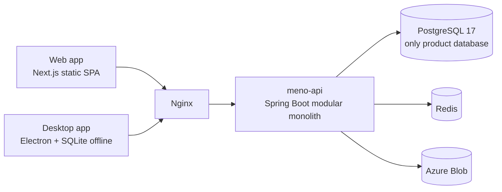

# MENO — Pharmacy Management, Simplified

**MENO** is an enterprise pharmacy ERP for **retail medical shops**, **wholesale distributors** and **pharmacy chains** in India: one multi-tenant platform with Retail and Wholesale editions, batch-wise inventory, GST, accounting, compliance registers and offline-capable counter billing. Built by **Setups Works**.

| | |
|---|---|
| **Status** | Foundation (P0): architecture, documentation and planning are complete; application code starts in P1 |
| **Team board** | MENO Hub: https://setupsworks-pms.vercel.app (sign in with your team email) |
| **Scope** | 284 features · 255 pages · 10 roles · 8 phases (P0–P7) |
| **Pilot target** | End of P5 (≈ June 2027), see [PHASES.md](docs/planning/PHASES.md) |

---

## Contents

- [What MENO does](#what-meno-does)
- [Architecture at a glance](#architecture-at-a-glance)
- [Repository layout](#repository-layout)
- [Getting started](#getting-started)
- [How we work](#how-we-work)
- [Team and ownership](#team-and-ownership)
- [Documentation map](#documentation-map)
- [MENO Hub (project management)](#meno-hub-project-management)

---

## What MENO does

| Area | Highlights |
|---|---|
| Retail POS | Keyboard-first billing, barcode, FEFO batch picker, split payments, prescriptions for scheduled drugs, thermal printing, **offline billing** on the desktop app |
| Wholesale | Orders → pick → invoice, price lists, schemes and free quantity, credit limits, dispatch, e-invoice and e-way bill preparation |
| Purchase & inventory | PO, GRN, purchase entry and CSV import, batch and expiry tracking, movement ledger, transfers, stock audit, reorder |
| Returns | Sales/purchase returns, inspection, expiry and breakage claims, credit/debit notes |
| Finance | Double-entry ledger posted automatically, receipts, payments, books, bank reconciliation, final accounts, Tally export |
| GST & compliance | Tax calculation, HSN summary, GSTR-1/3B preparation and export, ITC, Schedule H/H1/X registers, licences |
| Reports & dashboards | Role-based dashboards, report centre with filters and exports, branch comparison |
| Administration | Companies, branches, warehouses, users, roles and permissions, approvals, audit logs, imports/exports, subscriptions |

Full catalogue: [FEATURES.md](docs/product/FEATURES.md) · every screen: [PAGES.md](docs/product/PAGES.md) · roles: [ROLES_AND_DASHBOARDS.md](docs/product/ROLES_AND_DASHBOARDS.md).

## Architecture at a glance



| Layer | Technology |
|---|---|
| Web | Next.js (static export), React, TypeScript, Tailwind v4, shadcn/ui, TanStack Query, React Hook Form + Zod |
| Desktop | Electron, SQLite (SQLCipher) offline store, sync engine |
| Backend | Java 21, Spring Boot 4, Spring Modulith, Spring Security, JPA, Flyway |
| Data | **PostgreSQL 17** (shared schema + row-level security), Redis, S3-compatible storage |
| Infra | Docker, Docker Compose, Nginx, GitHub Actions, Azure VM (student plan), Prometheus, Grafana, Loki, Sentry |

Non-negotiables: tenant isolation, stock only through movements, exact money (`BigDecimal` / decimal.js), immutable posted documents, **four-layer validation and no hard-coded business values** ([VALIDATION_AND_BUSINESS_RULES.md](docs/architecture/VALIDATION_AND_BUSINESS_RULES.md)). Details: [ARCHITECTURE.md](docs/architecture/ARCHITECTURE.md).

## Repository layout

```
apps/web               Next.js SPA: back office, POS, wholesale (talks only to meno-api)
apps/desktop           Electron: offline billing, printers, scanners, auto-update
apps/mobile            Deferred to P7
backend/meno-api       Spring Boot modular monolith (21 modules, each with its AGENTS.md)
packages/              Shared TS: ui, api-client, types, validation, billing-engine, config
contracts/             OpenAPI spec, GST/pricing test vectors, sync protocol
infrastructure/        Docker, Nginx, Azure (Bicep), monitoring, backups, env examples
project-management/    MENO Hub: the team's project management app (Next.js + MongoDB, separate from the product)
scripts/               Repo tooling (page catalogue generator, design check, codegen)
docs/                  Product, architecture, design, data, API, security, testing, team, planning, ADRs
```

Full tree: [FOLDER_STRUCTURE.md](docs/architecture/FOLDER_STRUCTURE.md).

## Getting started

New to the team? Follow [ONBOARDING.md](docs/team/ONBOARDING.md), then read [AGENTS.md](AGENTS.md) and your own folder in [docs/team/members/](docs/team/members/README.md).

From P1 (when the scaffolding lands):

```bash
cp .env.example .env              # local values only, never commit
docker compose up -d              # postgres, redis, minio, mailpit
pnpm install && pnpm dev          # web at http://localhost:3000
cd backend/meno-api && ./mvnw spring-boot:run
pnpm typecheck && pnpm test && pnpm check:design
```

Environment templates for every environment: [infrastructure/env/](infrastructure/env/README.md).

## How we work

- **Never push to `main` or `develop`.** Branch (`feature/<task#>-name`), push, open a Pull Request, get a CODEOWNER review and green CI. See [WORKFLOW.md](docs/team/WORKFLOW.md).
- **No AI attribution** in commits or PRs (no `Co-Authored-By` AI lines, no "Generated with" footers). The developer is the author.
- **Conventional Commits**: `feat(inventory): add FEFO batch selection`.
- **Contract first**: backend merges the API contract before the frontend builds against it ([CONFLICT_FREE_COLLABORATION.md](docs/team/CONFLICT_FREE_COLLABORATION.md)).
- **AI agents** follow [AGENTS.md](AGENTS.md) and [AI_WORKFLOW.md](docs/team/AI_WORKFLOW.md); role agents live in `.claude/agents/`.
- **Every task** lives in MENO Hub with a description, checklist and owner.

## Team and ownership

| Member | Role | Owns |
|---|---|---|
| Nitheesh | Tech Lead & Full-stack Engineer (manages the team) | Platform & admin, finance, dashboards, CRM, reports backend; architecture; releases |
| Kamesh | Backend Engineer | Catalog, parties, pricing, purchase, inventory, sales, returns, compliance, GST modules |
| Meyyarivu | Frontend Lead + QA | Design system, app shell, POS, purchase, inventory, wholesale and GST screens; QA for Nitheesh's and Ashok's screens |
| Prakalya | Business Analyst + QA (part-time) | Requirements, stories, workflows, UAT; QA for masters, parties, returns, compliance, CRM |
| Ashok | QA Lead + Frontend | Test strategy, QA for core modules, critical scenarios, release recommendation; medicine master, parties, returns, compliance and reports screens |
| Jeeva | DevOps Engineer | Infrastructure, CI/CD, monitoring, backups, desktop packaging |

Single source of truth: [OWNERSHIP_MATRIX.md](docs/team/OWNERSHIP_MATRIX.md) · RACI: [TEAM_AND_OWNERSHIP.md](docs/team/TEAM_AND_OWNERSHIP.md).

## Documentation map

| Need | Read |
|---|---|
| Rules for humans and AI agents | [AGENTS.md](AGENTS.md) |
| Vision, features, pages, roles, glossary | [docs/product/](docs/product/) |
| Architecture, modules, offline sync, tenancy, calculations, validation | [docs/architecture/](docs/architecture/ARCHITECTURE.md) |
| Design language and sidebar | [DESIGN_LANGUAGE.md](docs/design/DESIGN_LANGUAGE.md), [NAVIGATION.md](docs/design/NAVIGATION.md) |
| Data model (PostgreSQL) and API | [DATA_MODEL.md](docs/database/DATA_MODEL.md), [API_GUIDELINES.md](docs/api/API_GUIDELINES.md) |
| Security, testing, deployment | [SECURITY.md](docs/security/SECURITY.md), [TEST_STRATEGY.md](docs/testing/TEST_STRATEGY.md), [AZURE_DEPLOYMENT.md](docs/deployment/AZURE_DEPLOYMENT.md) |
| Phases, readiness, current state | [PHASES.md](docs/planning/PHASES.md), [PRODUCTION_READINESS.md](docs/planning/PRODUCTION_READINESS.md), [CURRENT_STATE.md](docs/planning/CURRENT_STATE.md) |
| Decisions | [docs/decisions/](docs/decisions/README.md) (14 ADRs) |
| Compliance research | [COMPLIANCE.md](docs/compliance/COMPLIANCE.md) |

## MENO Hub (project management)

[`project-management/`](project-management/README.md) is the team's own board, deployed at **https://setupsworks-pms.vercel.app**. It imports this repository's plan (phases, member plans, features, pages, QA, compliance, runbooks) into boards and tasks, with live updates, comments, @mentions, notifications, team progress and Features / Pages checklists. When every task in the Hub is Done, MENO is in production.

---

MENO supports a licensed pharmacy's record-keeping; it does not replace the pharmacist's legal responsibilities. The original planning document is kept at [base-plan.md](base-plan.md).

© Setups Works
