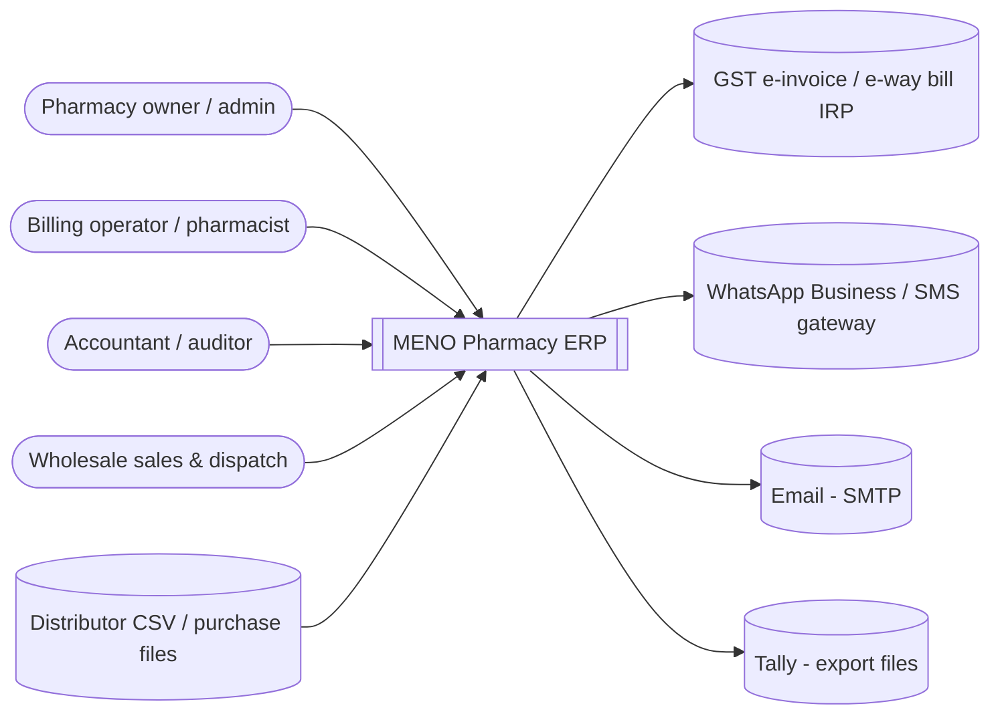
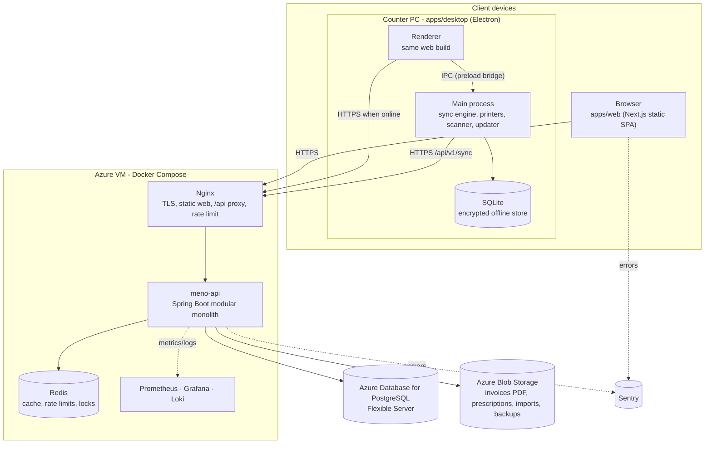
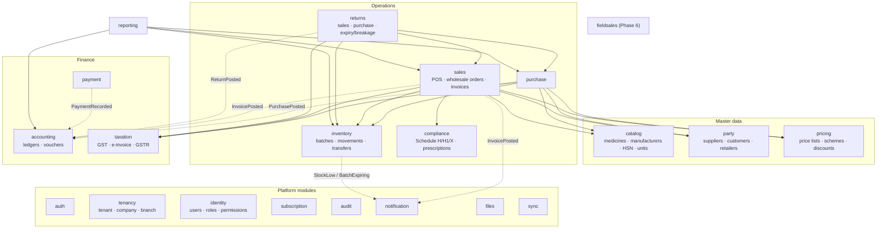
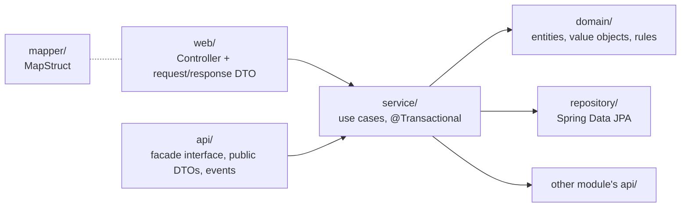
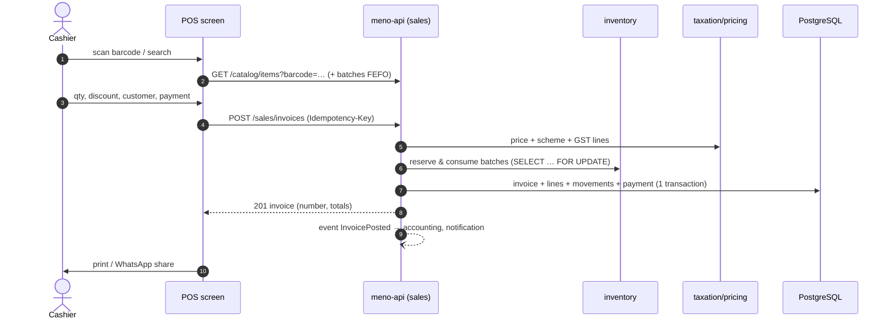
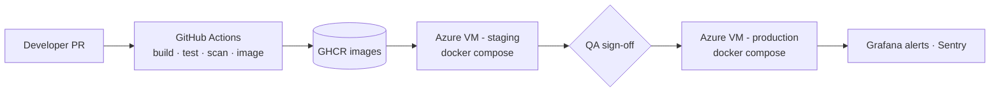

# MENO architecture

> Audience: every developer and every AI agent. Diagrams are Mermaid (GitHub renders them; agents can read them as text).
> Decisions behind this design are recorded in [`docs/decisions/`](../decisions/README.md).

## 1. Shape of the system in one sentence

A **single Spring Boot modular monolith** (`meno-api`) owns all business rules and data in PostgreSQL; a **Next.js SPA** (`apps/web`) is the UI in the browser; an **Electron desktop app** (`apps/desktop`) wraps the same UI and adds an **offline SQLite store + sync engine** for counter billing; everything runs in **Docker** on an **Azure VM** behind **Nginx**.

## 2. System context (C4 level 1)

## 3. Containers (C4 level 2)

Key points:

- **Nginx** serves the static web build and proxies `/api/*` to `meno-api` → same origin, so auth cookies stay `HttpOnly; Secure; SameSite=Strict`.
- **The desktop renderer is the web build.** When online it talks to the API like the browser. When offline, the data layer switches to the IPC bridge (`window.meno.local`) and the main process serves reads/writes from SQLite (see [OFFLINE_SYNC.md](OFFLINE_SYNC.md)).
- **No Next.js server.** The web app is exported static (`output: 'export'`). This keeps one backend, makes the desktop bundle trivial, and Nginx can serve it for free.

## 4. Backend components (C4 level 3)

Solid arrow = synchronous call through the target's `api` facade. Dotted = domain event (Spring Modulith `@ApplicationModuleListener`, persisted in the event publication registry so nothing is lost on a crash). Every module also depends on `tenancy`, `identity` and `audit` (omitted for clarity). Full catalogue: [MODULES.md](MODULES.md).

### Layers inside a module

## 5. Key flows

### 5.1 Retail counter sale (online)

### 5.2 Purchase entry → stock

Supplier invoice entered (or imported from distributor CSV) → lines matched to catalog items → batches created/updated (batch no, expiry, MRP, PTR, free qty) → `inventory_movement(+)` per batch → supplier ledger credited via `PurchasePosted` event.

### 5.3 Offline sale → sync

See [OFFLINE_SYNC.md](OFFLINE_SYNC.md) §4.

## 6. Deployment

Details: [docs/deployment/AZURE_DEPLOYMENT.md](../deployment/AZURE_DEPLOYMENT.md).

**Until the pilot ([ADR-0017](../decisions/0017-azure-app-service-free-tier.md)):** GitHub Actions tests every PR, then deploys the jar to an Azure App Service: `develop` → staging, `main` → production, each followed by a smoke test. The VM + Docker Compose flow above is the target once we need Redis, nginx and monitoring on our own host. Setup: [AZURE_APP_SERVICE.md](../deployment/AZURE_APP_SERVICE.md).

## 7. Quality attributes and how we meet them

| Attribute | Target | Mechanism |
|---|---|---|
| Correct money | 0 rounding drift | `BigDecimal`, shared test vectors, immutable posted docs |
| Correct stock | no oversell, no negative stock (unless tenant allows) | movement ledger, row locks per batch, nightly reconciliation |
| Tenant isolation | 0 cross-tenant reads | token-derived tenant, Hibernate filter + PostgreSQL RLS, cross-tenant tests |
| POS speed | item search < 150 ms p95, invoice post < 500 ms p95 | indexes, Redis cache for catalog, keyboard-first UI |
| Offline | 3 days of counter billing without internet | SQLite, local numbering series, idempotent sync |
| Availability | 99.5 % (single VM, documented recovery) | health checks, restart policies, daily backups + restore drill |
| Auditability | every write traceable | audit module, posted-document snapshots |
| Maintainability | a fresher can add a module safely | module template, Spring Modulith tests, AGENTS.md per folder |

## 8. What we deliberately did not do (yet)

- Microservices, Kafka, Kubernetes — unnecessary for 6 people; Spring Modulith lets us extract later.
- Schema-per-tenant — shared schema + RLS is simpler to migrate; revisit for very large tenants.
- Native mobile — deferred to Phase 6 (ADR-0008).
