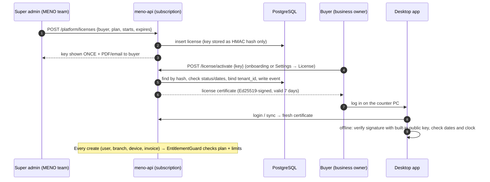

# Licensing — license keys, plans and entitlements

> How MENO is sold and switched on. The MENO team (super admin) creates a **license** for a buyer; the buyer enters its **license key** once; MENO then knows the buyer's **plan, edition, limits and expiry** and enforces them. Decision record: [ADR-0015](../decisions/0015-license-keys-signed-certificates.md). Features: `LIC-01 … LIC-11` in [FEATURES.md](../product/FEATURES.md) §23. Module: `subscription` (owner Nitheesh). Teaching lesson: MENO Hub → Learn → "Licensing: how MENO is sold and switched on".
>
> ⚠ Items marked ⚠ are business rules Nitheesh must confirm before build (prices, grace length, what is blocked after expiry).

## 1. Words

| Word | Meaning |
|---|---|
| **Plan** | A product package defined by the MENO team as data: edition, limits, features, duration, grace days. Example: `RETAIL_STD_1Y`. |
| **License** | One sale: a buyer + a plan + start and expiry dates (+ optional limit overrides). Has one **license key**. |
| **License key** | The code the buyer types: `MENO-7K3QP-9XW2M-H4TZR-C8VNF`. Proves the buyer paid. It is **not** the license itself; it only points to it. |
| **Activation** | Entering the key in a tenant: the license is bound to that tenant, forever (until transferred by a super admin). |
| **License certificate** | A short-lived, **digitally signed** token the server gives the tenant after activation and on every login/sync. Carries plan, edition, limits and dates. The desktop app checks the signature offline. |
| **Entitlement** | What the tenant may do right now: computed from the license + today's date + current usage. |

## 2. Flow



## 3. The license key

- **Format:** `MENO-` + 20 characters in **Crockford Base32** (`0-9 A-Z` without `I L O U`) in four groups of 5, the last character being a **check character** computed with the **Luhn mod-32** algorithm over the same alphabet (so it is always a normal, typeable character). 19 random characters = 95 bits from a CSPRNG (`SecureRandom`). Guessing one is not practical, and activation is rate-limited.
- **Normalising input:** upper-case, remove spaces and hyphens, read `I`/`L` as `1` and `O` as `0`. So `meno 7k3qp-9xw2m…` and `MENO-7K3QP-9XW2M…` are the same key.
- **Check character first:** the web form validates the check character before calling the server, so a typo says "That key has a typing mistake" instantly, without a network call.
- **Stored hashed:** the database keeps `key_hash = HMAC-SHA256(pepper, normalised key)` and the last 4 characters for display (`…8VNF`). The pepper is a secret (env / Azure Key Vault), never in git. A database leak therefore leaks no usable keys.
- **Shown once:** the super admin sees the full key only right after creating it (and can download a PDF / email it to the buyer). Lost key → **re-issue** (a new key; the old hash is replaced and stops working).

## 4. The license certificate

A compact **JWS signed with Ed25519** (`alg: EdDSA`). The private key lives only on the server (secret, rotated with a `kid`); the matching public keys ship inside the web and desktop builds.

```json
{
  "kid": "lic-2027-01",
  "lic": "0193f1a2-…",            // license id (UUIDv7)
  "tid": "0193e7c0-…",            // tenant it is activated on
  "plan": "RETAIL_STD_1Y",
  "edition": "RETAIL",            // RETAIL | WHOLESALE | BOTH
  "limits": { "users": 5, "branches": 1, "devices": 2, "invoicesPerMonth": null },
  "features": ["OFFLINE_BILLING", "WHATSAPP_SHARE"],
  "starts": "2027-04-01", "expires": "2028-03-31", "graceUntil": "2028-04-15",
  "iat": 1795400000, "exp": 1796004800  // certificate itself: 7 days, then refresh
}
```

- The **server never trusts** a certificate sent by a client: it always reads the license from the database. The certificate exists for the **offline desktop** and so the UI can show plan/limits without a call.
- `exp` (certificate) is short (7 days, ⚠ setting) so a revoked or suspended license stops working on desktops within days even if they stay offline.
- Desktop offline checks: signature valid with a known `kid`, `tid` matches the device's tenant, `exp` not passed, and the **clock check**: the app stores the latest server time it has seen; if the PC clock is more than 5 minutes behind it, billing is restricted with "Your PC's date is wrong. Connect to the internet to fix it."

## 5. Lifecycle

| Stored status | Meaning |
|---|---|
| `ISSUED` | Created by a super admin, not activated yet |
| `ACTIVE` | Activated on a tenant |
| `SUSPENDED` | Paused by a super admin (e.g. payment dispute); can be resumed |
| `REVOKED` | Ended for good (fraud, refund); cannot be resumed |

Time-based states are **computed, never stored** (so no nightly job can get them wrong):

| Computed state | When | What the tenant sees |
|---|---|---|
| Valid | today ≤ `expires_at` | Normal |
| Expiring | within 30 / 15 / 7 / 1 days of expiry ⚠ | Banner + email/in-app reminder to the owner |
| Grace | `expires_at` < today ≤ `expires_at + grace_days` | Red banner; everything still works |
| Expired | after grace | **Restricted mode** (below) |

**Restricted mode** ⚠ (confirm exactly what is blocked):
- Always allowed: sign in, view everything, reports, **export all data**, record payments received, and **sync of bills already made offline** before the grace end (data integrity beats licensing: AGENTS.md §1).
- Blocked: creating new sales, purchases and other documents, adding users, branches and devices.
- Never: deleting or hiding the tenant's data.

## 6. Enforcement (server first)

- `subscription.api.EntitlementGuard` is the only place that answers "may this tenant do X?". Other modules call it; no module reads license tables.
  - `requireEdition(WHOLESALE)` (existing `EditionGuard`, now backed by the license)
  - `requireFeature("OFFLINE_BILLING")`
  - `requireCapacity(USERS | BRANCHES | DEVICES)`: counts current active rows against the limit before creating one
  - `requireWritable()`: refuses document creation in restricted mode
- Refusals are RFC 9457 problems with a stable `code` (`license_expired`, `license_limit_reached`, `license_edition`, `license_feature`) so the UI can show a friendly message and an upgrade hint.
- The UI hides or disables what the plan doesn't include and explains why, but the **server check is the rule** (four-layer validation, AGENTS.md §4.12).
- `invoicesPerMonth`: ⚠ soft limit (warn the owner at 80 % and 100 %) or hard limit? Default: soft. Never block the counter in the middle of a sale for this.
- Activating a desktop counts against `limits.devices`; revoking a device frees the slot.

## 7. Data model (`subscription` module)

Plans and licenses are **platform data**: created by super admins through `/api/v1/platform/*` (BYPASSRLS role, every call audited, MULTI_TENANCY.md). A tenant reads only its own license, through RLS on `tenant_id`.

- `plan(id, code unique, name, edition, limits jsonb, features text[], duration_months, grace_days, list_price numeric(18,4), currency, is_active, valid_from, valid_to)` — data, never hard-coded (ADR-0014)
- `license(id uuidv7, key_hash bytea unique, key_last4, plan_id, buyer_name, buyer_gstin null, buyer_email, buyer_phone, edition, limits jsonb /* plan limits + overrides, snapshotted */, features text[], starts_at date, expires_at date, grace_days, is_trial, status, tenant_id null, activated_at, activated_by, notes, created_by, created_at, updated_at, version)`
  - CHECK `expires_at >= starts_at`, CHECK `status in (...)`, CHECK `(status = 'ISSUED') = (tenant_id is null)`
  - partial UNIQUE: one `ACTIVE` license per tenant at a time
- `license_event(id, license_id, type /* ISSUED, ACTIVATED, EXTENDED, PLAN_CHANGED, SUSPENDED, RESUMED, REVOKED, KEY_REISSUED, TRANSFERRED */, before jsonb, after jsonb, reason, by_user, at)` — insert-only history
- `license_activation_attempt(id, ip_hash, tenant_id null, key_last4, success, at)` — for rate limiting and abuse review
- `tenant.plan_code` becomes a derived read of the active license (kept for reporting).

The plan's limits and features are **snapshotted onto the license** when it is issued, like prices on an invoice: changing a plan later never changes licenses already sold.

## 8. API

| Who | Method & path | Notes |
|---|---|---|
| Super admin | `GET/POST /api/v1/platform/plans`, `PATCH /platform/plans/{id}` | permission `platform.plan.manage` |
| Super admin | `POST /api/v1/platform/licenses` | `Idempotency-Key` required; returns the key **once** |
| Super admin | `GET /api/v1/platform/licenses?status=&expiringBefore=&q=` | paged |
| Super admin | `GET /api/v1/platform/licenses/{id}` | with events and activations |
| Super admin | `POST /platform/licenses/{id}/extend` · `/change-plan` · `/suspend` · `/resume` · `/revoke` · `/reissue-key` · `/transfer` | each needs a `reason`; audited |
| Business owner | `POST /api/v1/license/activate {key}` | permission `admin.license.activate`; 5 attempts / 15 min per IP and per tenant |
| Tenant users | `GET /api/v1/license` | plan, dates, computed state, limits with current usage, masked key |
| Tenant apps | `GET /api/v1/license/certificate` | fresh signed certificate (also returned on login and sync) |

Super-admin actions require 2FA (PLT-09) and are checked by **permission** (`platform.license.*`), never by role name (ADR-0014).

## 9. Security checklist

- Keys: CSPRNG, check character, HMAC-hashed with a secret pepper, shown once, never logged (log `key_last4` only).
- Activation: rate-limited, same error for "unknown key" and "already used elsewhere" ("That key can't be activated. Check it or contact MENO support."), every attempt recorded.
- Signing key: Ed25519 private key only in secrets; `kid` rotation keeps old public keys in the apps until their certificates expire.
- The server re-checks the database on every protected action; the certificate is only for offline use and display.
- Tests: cross-tenant (tenant A can't read B's license), permission tests for every platform endpoint, a tampered certificate is rejected, a revoked license stops a desktop within one certificate lifetime, an expired tenant can still sync bills made before expiry.

## 10. Screens

| Page | Route | Who | Feature |
|---|---|---|---|
| Plans | `/platform/plans` | SA | LIC-01 |
| Licenses (list, filters: status, expiring, plan) | `/platform/licenses` | SA | LIC-08 |
| New license (shows the key once) | `/platform/licenses/new` | SA | LIC-02 |
| License detail (history, activations, actions) | `/platform/licenses/[id]` | SA | LIC-08 |
| Enter license key | `/onboarding/license` | OW | LIC-03 |
| License & plan (usage bars, expiry, renew) | `/admin/license` | OW | LIC-09 |
