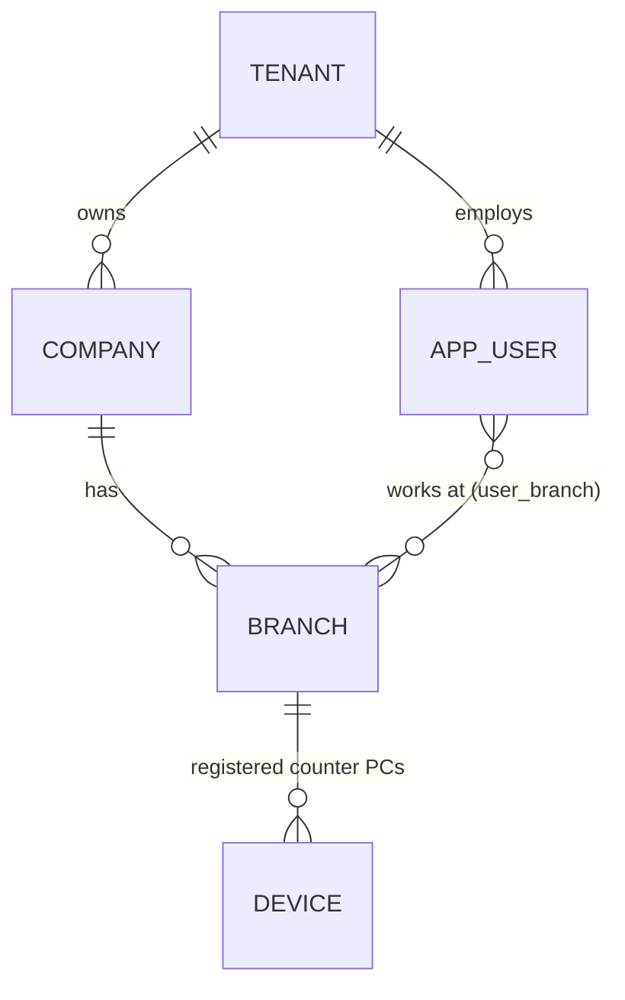

# Multi-tenancy

## Model

- **Tenant** = the paying business (one subscription). **Company** = a legal entity with its own GSTIN (a tenant may own a retail company and a wholesale company). **Branch** = a shop/warehouse with its own stock and number series.
- Edition (Retail / Wholesale / Both) is a property of the **company**; it toggles menus and endpoints via `EditionGuard`.

## Isolation — defence in depth

1. **Token:** JWT carries `tid` (tenant), `uid`, allowed `bid`s (branches). The active branch is chosen in the UI and sent as `X-Branch-Id`; the server checks it against the token's list.
2. **Request context:** `TenantContextFilter` puts tenant/branch in a request-scoped `TenantContext`. Nothing reads tenant from the body.
3. **Hibernate filter:** every tenant entity extends `TenantScopedEntity`; a filter adds `tenant_id = :tid` to every query automatically.
4. **PostgreSQL RLS:** the app connects as role `meno_app` (not owner). Each transaction runs `SET LOCAL app.tenant_id = '<uuid>'`; policies `USING (tenant_id = current_setting('app.tenant_id')::uuid)`. If code forgets a filter, the database still refuses.
5. **Tests:** `CrossTenantAccessTest` base class — every controller test creates two tenants and asserts 404 (not 403, to avoid leaking existence) for the other tenant's ids.
6. **Background jobs** iterate tenants explicitly and set the context per tenant. Never run a job "for all rows".

## Platform (super-admin) access

The `PLATFORM_ADMIN` role uses a separate connection role with `BYPASSRLS`, only in `/api/v1/platform/*` endpoints, every call audited. Support staff impersonation requires the tenant admin's time-boxed consent.

## Future

If a tenant outgrows the shared DB: move it to a dedicated database with the same schema (routing datasource by `tid`). No code change beyond config — that's why we never hard-code cross-tenant joins.
