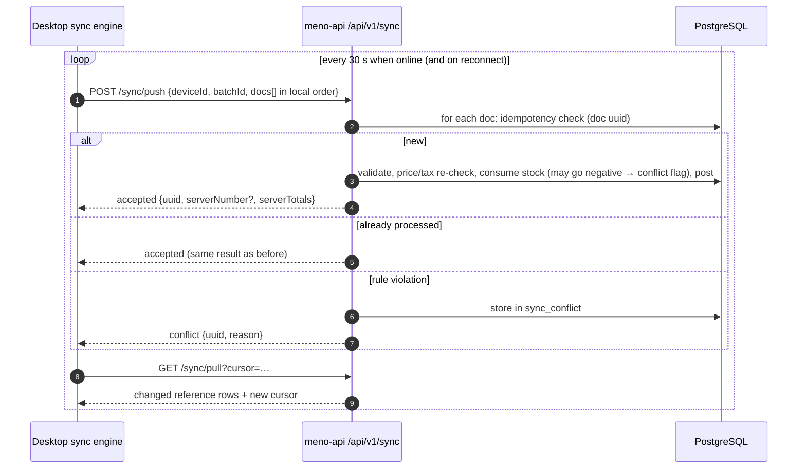

# Offline billing and synchronisation

> The hardest part of MENO. Read fully before touching `apps/desktop/src/offline`, `packages/billing-engine` or the backend `sync` module. Owner: Nitheesh (design) + Kamesh (server) + Meyyarivu (client).

## 1. Scope — what works offline

| Works offline (desktop only) | Online only |
|---|---|
| Retail POS invoice (cash/UPI-recorded/card-recorded/credit to known customer) | Purchases, GRN, imports |
| Held bills | Wholesale credit invoices above credit limit checks* |
| Sales return against an invoice from the same device | Stock transfers, adjustments, stock count |
| Item/batch/customer search, price lookup | Accounting, reports beyond today's device summary |
| Day-end summary for the device | Master data edits, user admin, e-invoice |

\* Wholesale invoices offline are allowed only if the tenant enables it, with a per-device credit cap.

## 2. Local data on the device

SQLite (encrypted with SQLCipher, key in OS keychain via Electron `safeStorage`) holds:

- **Reference snapshot** (read-only, pulled from server): items, batches with available qty for **this branch**, price lists, schemes, tax rates, customers, doctors, settings. Delta-pulled by `updated_at` cursor.
- **Outbox** (written locally): invoices, returns, payments, held bills — each with a client UUIDv7, device id, local document number, status.
- **Local stock ledger**: offline consumption is subtracted from snapshot qty so the cashier sees realistic stock.

## 3. Identity and numbering

- Device registers once (online) → server issues `device_id` + a **dedicated number series block** (e.g. `TBM-D2/24-25/00001…` per device and financial year). Offline invoices are therefore legally numbered without ever colliding.
- All offline rows use UUIDv7 primary keys generated on the device; the server stores them unchanged.

## 4. Sync protocol

Rules:

1. **Push before pull.** Order inside a batch is preserved; a batch is processed in one transaction per document (not per batch) so one bad doc doesn't block the rest.
2. **Idempotent by document UUID.** The engine retries forever with exponential backoff (max 5 min); duplicates are impossible.
3. **Server is the authority** for totals: it recomputes with Java `taxation`/`pricing`. If totals differ by more than ₹0.01, the doc is accepted as-is (the customer already paid) **and** a `TOTAL_MISMATCH` conflict is raised for review — this means a bug in `billing-engine` parity.
4. **Never silently overwrite.** Conflicts go to `sync_conflict` and show in the manager's "Sync issues" screen.

## 5. Conflict policies

| Conflict | Policy |
|---|---|
| Stock went negative (another counter sold the same batch) | Accept sale (goods already left), record negative balance, raise `NEGATIVE_STOCK` for manager to adjust/transfer |
| Batch expired between snapshot and sale | Should be blocked locally; if it reaches server: accept + `EXPIRED_BATCH_SOLD` compliance alert |
| Price changed on server after snapshot | Accept device price (that's what customer paid), log `STALE_PRICE` info |
| Customer credit limit exceeded | Accept, flag `CREDIT_LIMIT` for the manager |
| Item deleted/blocked on server (e.g. banned drug) | Accept, flag `BLOCKED_ITEM` (high severity) |
| Reference data edited locally | Impossible by design — reference data is read-only on device |

## 6. Security

- Device must be registered by a Branch Manager; it can be revoked (server rejects its pushes, app wipes local data on next connect).
- Offline login: the user must have logged in online on this device within the last N days (tenant setting, default 3); a salted hash of a PIN is cached, not the password.
- Local DB encrypted; logs never contain patient names or prescription details.

## 7. Parity testing

`packages/billing-engine` and Java `taxation`/`pricing` both run every JSON case in `contracts/test-vectors/**`. CI fails if either disagrees. Adding a scheme type or tax rule = add vectors first.

## 8. Health indicators (shown in the desktop status bar)

`Online · synced 12s ago` / `Offline · 37 bills waiting` / `Sync issue — 2 conflicts`. Managers get a notification if a device hasn't synced in 24 h.
