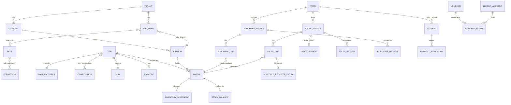

# Data model

> Database: **PostgreSQL 17 only** (ADR-0013). Validation and no-hard-coding rules: [VALIDATION_AND_BUSINESS_RULES.md](../architecture/VALIDATION_AND_BUSINESS_RULES.md).

> v1 draft (P0). Kamesh owns this file; update it in the same PR as every migration. Tables are grouped by module; a module only writes its own tables.

## 1. Conventions (every table)

| Rule | Detail |
|---|---|
| Names | `snake_case`, singular (`sales_invoice`, `inventory_movement`) |
| Primary key | `id uuid` — **UUIDv7** generated by the app (time-ordered; safe offline) |
| Tenant | `tenant_id uuid not null` on every tenant-owned table; `branch_id uuid` where data is per branch |
| Audit columns | `created_at timestamptz`, `created_by uuid`, `updated_at timestamptz`, `updated_by uuid` |
| Optimistic lock | `version bigint not null default 0` on mutable rows |
| Money | `numeric(18,4)`; percentages `numeric(7,4)`; qty `numeric(14,3)` (loose units) |
| Dates | `date` for business dates (invoice date, expiry), `timestamptz` (UTC) for events |
| Status | `text` + `CHECK` constraint (not PG enums — easier migrations) |
| Soft delete | Only for masters (`is_active`, `archived_at`). Documents are never deleted — reversed |
| Indexes | Every FK; every common filter **starting with `tenant_id`** (e.g. `(tenant_id, branch_id, invoice_date)`) |
| RLS | `ENABLE ROW LEVEL SECURITY` + `tenant_isolation` policy on every tenant table |
| Search | `pg_trgm` GIN index on item names/generic names; `unaccent` |
| Migrations | Flyway `V<yyyyMMddHHmm>__<module>_<what>.sql`; never edit applied ones |

## 2. Core ER (v1)

## 3. Key tables (columns abbreviated; audit/tenant cols implied)

### tenancy
- `tenant(id, name, status, plan_code)`
- `company(id, tenant_id, legal_name, gstin, state_code, edition[RETAIL|WHOLESALE|BOTH], pan)`
- `branch(id, tenant_id, company_id, name, code, address, state_code, dl_retail_no, dl_wholesale_no, dl_expiry, pharmacist_name, pharmacist_reg_no)`
- `financial_year(id, tenant_id, company_id, start_date, end_date, status[OPEN|CLOSED])`
- `number_series(id, tenant_id, branch_id, doc_type, fy_id, device_id null, prefix, next_value)` — row-locked on use

### catalog
- `item(id, tenant_id, name, brand, generic_name, manufacturer_id, dosage_form, pack_size, pack_unit, loose_unit, conversion, hsn_id, gst_rate, schedule[OTC|H|H1|X|NDPS|G], rx_required, storage, is_active)`
- `composition(id, tenant_id, salt, strength)` ; `item_composition(item_id, composition_id)`
- `barcode(id, tenant_id, item_id, code, unique(tenant_id, code))`
- `item_branch_setting(item_id, branch_id, min_qty, max_qty, reorder_qty, rack_location)`

### party
- `party(id, tenant_id, type[SUPPLIER|CUSTOMER|RETAILER|DOCTOR], name, phone, gstin, state_code, dl_no, dl_expiry, credit_limit, credit_days, price_list_id, opening_balance)`

### inventory
- `batch(id, tenant_id, branch_id, item_id, batch_no, mfg_date, expiry_date, mrp, ptr, purchase_rate, landed_cost, unique(tenant_id, branch_id, item_id, batch_no, expiry_date, mrp))`
- `inventory_movement(id, tenant_id, branch_id, batch_id, qty_change, movement_type[PURCHASE|SALE|SALES_RETURN|PURCHASE_RETURN|EXPIRY_RETURN|TRANSFER_OUT|TRANSFER_IN|ADJUSTMENT|OPENING|COUNT], source_type, source_id, source_line_id, occurred_at)` — **insert-only**
- `stock_balance(batch_id PK, tenant_id, branch_id, qty, updated_at)` — derived; updated in the same tx as the movement
- `stock_transfer`, `stock_adjustment`, `stock_count` (+ lines)

### purchase / sales / returns (documents)
Common header columns: `id, tenant_id, branch_id, fy_id, doc_no, doc_date, party_id, status[DRAFT|POSTED|REVERSED], place_of_supply, taxable_total, cgst_total, sgst_total, igst_total, cess_total, discount_total, round_off, grand_total, party_snapshot jsonb, idempotency_key, posted_at, reversed_by_id`.
Common line columns: `id, doc_id, line_no, item_id, batch_id, qty, free_qty, rate, mrp, discount_pct, scheme_id, taxable, gst_rate, cgst, sgst, igst, line_total, item_snapshot jsonb`.

- `purchase_invoice(+supplier_invoice_no, supplier_invoice_date)` / `purchase_line`
- `sales_invoice(+sale_type[RETAIL|WHOLESALE], customer_name, doctor_id, prescription_id, device_id, origin[ONLINE|OFFLINE], einvoice_irn)` / `sales_line`
- `sales_return`, `purchase_return`, `expiry_return` (+lines), `credit_note`, `debit_note`

### compliance
- `prescription(id, tenant_id, branch_id, doctor_id, patient_name, patient_age, rx_number, rx_date, file_id)`
- `schedule_register_entry(id, tenant_id, branch_id, sales_line_id, schedule, item_name, batch_no, qty, patient_name, patient_address, doctor_name, doctor_reg_no, sold_at)` ⚠ fields per legal review

### payment / accounting
- `payment(id, tenant_id, branch_id, party_id, direction[IN|OUT], mode[CASH|UPI|CARD|BANK|CHEQUE], amount, reference, payment_date)`, `payment_allocation(payment_id, document_type, document_id, amount)`
- `ledger_group(id, tenant_id, company_id, parent_id null, code, name, nature[ASSET|LIABILITY|EQUITY|INCOME|EXPENSE], affects_gross_profit, system_code null, is_system, sort_order)` — the chart-of-accounts tree (ACX-14). UNIQUE (company_id, system_code); a child's nature equals its parent's (CHECK via trigger); system groups can't be deleted or change nature.
- `ledger_account(id, tenant_id, company_id, group_id, code, name, nature, system_code null, is_system, party_id null, opening_balance numeric(18,4), opening_side[DR|CR], active)` — nature always equals the group's nature; UNIQUE (company_id, system_code); UNIQUE (company_id, party_id) so each party has one ledger (ACX-16).
- `posting_rule(id, tenant_id, company_id, event, line_role, side[DR|CR], ledger_system_code, valid_from, valid_to)` — which system ledger each document line posts to (ACX-17), effective-dated.
- Defaults for groups, ledgers and posting rules: `docs/architecture/CHART_OF_ACCOUNTS.md` → `contracts/reference-data/chart-of-accounts.v1.json`, seeded per company by the books wizard (ACX-11).
- `voucher(id, tenant_id, company_id, type, date, source_type, source_id, narration)` / `voucher_entry(voucher_id, ledger_account_id, debit, credit)` — Σ debit = Σ credit (CHECK via trigger)

### platform
- `audit_log(id, tenant_id, user_id, action, entity_type, entity_id, before jsonb, after jsonb, ip, at)` — partitioned by month
- `idempotency_record(tenant_id, key, request_hash, response jsonb, created_at)` — TTL 7 days (online), permanent link for offline docs
- `device(id, tenant_id, branch_id, name, status, registered_by, last_sync_at)`, `sync_conflict(...)`
- `event_publication` (Spring Modulith registry)

### subscription (licensing, `docs/architecture/LICENSING.md`, ADR-0015)
- `plan(id, code unique, name, edition, limits jsonb, features text[], duration_months, grace_days, list_price numeric(18,4), currency, is_active, valid_from, valid_to)` — platform data
- `license(id, key_hash bytea unique, key_last4, plan_id, buyer_name, buyer_gstin, buyer_email, buyer_phone, edition, limits jsonb, features text[], starts_at, expires_at, grace_days, is_trial, status[ISSUED|ACTIVE|SUSPENDED|REVOKED], tenant_id null, activated_at, activated_by, notes, version)` — key stored only as HMAC hash; plan limits snapshotted; one ACTIVE license per tenant (partial unique); RLS lets a tenant read only its own row; expiring / grace / expired are computed from dates, never stored
- `license_event(id, license_id, type, before jsonb, after jsonb, reason, by_user, at)` — **insert-only** history
- `license_activation_attempt(id, ip_hash, tenant_id, key_last4, success, at)` — rate limiting and abuse review

### configuration (no hard-coding, ADR-0014)
- `state(code, name, gst_state_code)` · `tax_rate(id, rate, cess, valid_from, valid_to)` · `hsn_tax(hsn, tax_rate_id, valid_from, valid_to)`
- `unit(id, tenant_id, code, name, allows_decimal)` · `unit_conversion(item_id, from_unit, to_unit, factor)`
- `schedule_rule(schedule, rx_required, register_required, retention_years, ...)` ⚠ values confirmed in COMPLIANCE.md
- `payment_mode(id, tenant_id, code, name, kind, ledger_account_id, active)`
- `approval_rule(id, tenant_id, action, threshold_type, threshold_value, approver_permission)`
- `statutory_setting(key, value, valid_from, valid_to, source)` (e-invoice turnover, e-way bill value, …)
- `tenant_setting(tenant_id, key, value jsonb)` (near-expiry days, rounding, negative stock, MRP-inclusive, …)
- `notification_template(id, tenant_id, channel, event, body, approved_template_id)`

All effective-dated values are read for the **document date** and snapshotted on the document.

## 4. Integrity guarantees

| Guarantee | How |
|---|---|
| No oversell | `SELECT … FROM stock_balance WHERE batch_id IN (…) FOR UPDATE` in sales posting; CHECK `qty >= 0` unless tenant allows negative |
| Ledger = balance | Nightly job compares `Σ inventory_movement.qty_change` with `stock_balance.qty` per batch; mismatches alert |
| Balanced vouchers | Deferred constraint trigger on `voucher_entry` |
| Unique document numbers | Unique `(tenant_id, branch_id, doc_type, fy_id, doc_no)` |
| No duplicate posts | Unique `(tenant_id, idempotency_key)` on document headers |
| Selling price ≤ MRP | `CHECK (rate <= mrp)` on sales lines |
| Positive quantities | `CHECK (qty > 0)` on document lines; returns are separate documents |
| Valid GSTIN/HSN shape | `CHECK` with regex as a backstop to API validation |
