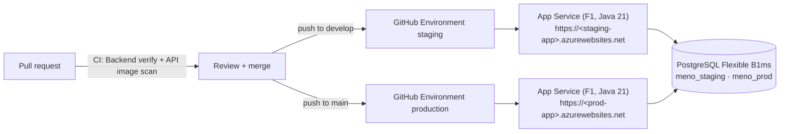

# meno-api on Azure App Service (free student setup)

Owner: Jeeva. Approver: Nitheesh. Decision: [ADR-0017](../decisions/0017-azure-app-service-free-tier.md). Workflows: [`ci.yml`](../../.github/workflows/ci.yml), [`deploy-api.yml`](../../.github/workflows/deploy-api.yml).



| Branch | GitHub Environment | App Service | URL | Swagger |
|---|---|---|---|---|
| `develop` | `staging` | `meno-api-stg` | <https://meno-api-stg.azurewebsites.net> | <https://meno-api-stg.azurewebsites.net/swagger-ui.html> |
| `main` | `production` | `meno-api-prod` | <https://meno-api-prod.azurewebsites.net> | off (smoke test fails if it is on) |

## What exists (set up 26-11-2026)

| Resource | Name | Notes |
|---|---|---|
| Resource group | `rg-meno` (Central India) | MENO only |
| App Service plan | `asp-meno-free` | Linux, **Free F1** |
| Web apps | `meno-api-stg`, `meno-api-prod` | Java 21 SE, HTTPS only, TLS 1.2+, FTPS off, app settings filled (DB, JWT keys per env, bootstrap owner) |
| PostgreSQL | `untitled-ws-pg-13oct26` in `nitheesh_group` (shared, B1ms, v16) | Databases `meno_staging`, `meno_prod`; roles `meno_stg_owner` / `meno_stg_app`, `meno_prod_owner` / `meno_prod_app` (staging credentials cannot open the production database) |
| GitHub Environments | `staging` (branch `develop` only), `production` (branch `main` only) | `AZURE_WEBAPP_NAME` + `AZURE_WEBAPP_PUBLISH_PROFILE` until OIDC is switched on |

The steps below are what was done, so the setup can be repeated or rebuilt.

Every deploy: `./mvnw verify` on the exact commit → upload `app.jar` → restart → Flyway migrates → smoke test (`/actuator/health` is UP, login rejects an empty body with 400, production does not serve `/v3/api-docs`).

## What it costs

Everything here is on free tiers for an Azure for Students subscription. ⚠ Check each price in the portal before you create it: free offers change.

| Resource | SKU | Note |
|---|---|---|
| 2 × App Service (Linux) | **Free F1** | 1 GB RAM, 60 CPU minutes a day, sleeps after ~20 idle minutes. Move production to B1 before the pilot (ADR-0017) |
| PostgreSQL Flexible Server | B1ms, 32 GB | 750 h a month free for 12 months on eligible student subscriptions. One server, two databases |
| Key Vault (optional) | Standard | Tiny per-operation cost; holds the JWT keys and DB passwords as references |

## One-time setup (a person does this, not an agent)

Names used: resource group `rg-meno`, plan `asp-meno-free`, apps `meno-api-stg` / `meno-api-prod` (the name becomes the URL). PostgreSQL reuses the existing server `untitled-ws-pg-13oct26` (the free 750 h cover one server).

### 1. PostgreSQL

Create **Azure Database for PostgreSQL – Flexible Server**, version 17, B1ms, public access. Then, as the admin user:

One pair of roles per environment (`<env>` = `stg` or `prod`), so staging credentials cannot open production:

```sql
create role meno_<env>_owner login password '<owner-password>';
create role meno_<env>_app   login password '<app-password>';
grant meno_<env>_owner to current_user;   -- the Azure admin is not a superuser
create database <meno_staging|meno_prod> owner meno_<env>_owner;
revoke connect on database <db> from public;
grant connect on database <db> to meno_<env>_owner, meno_<env>_app;
\connect <db>
grant usage on schema public to meno_<env>_app;
alter default privileges for role meno_<env>_owner in schema public grant select, insert, update, delete on tables to meno_<env>_app;
alter default privileges for role meno_<env>_owner in schema public grant usage, select on sequences to meno_<env>_app;
``` Firewall: add each App Service's **outbound IP addresses** (app → Networking → Outbound addresses). Avoid "Allow public access from any Azure service" (it lets every Azure customer try your login).

### 2. The two App Services

Portal → Create → Web App: **Publish: Code**, **Runtime stack: Java 21**, **Java web server stack: Java SE (Embedded Web Server)**, **OS: Linux**, region Central India, pricing plan **Free F1**. Do it twice (staging, production). Then on each app:

- Settings → Configuration → General settings: **SCM Basic Auth Publishing Credentials: On** (the publish profile needs it), HTTPS only: On, minimum TLS 1.2.
- Settings → Environment variables → App settings: the table below.
- Overview → **Download publish profile** (keep the file private; it is a deploy password).

| App setting | staging | production | Secret |
|---|---|---|---|
| `SERVER_PORT` | `80` | `80` | no (App Service Java SE routes traffic to port 80) |
| `JAVA_OPTS` | `-XX:MaxRAMPercentage=70 -XX:+UseSerialGC -XX:TieredStopAtLevel=1` | same | no (fits the 1 GB F1 plan, faster start) |
| `SPRING_PROFILES_ACTIVE` | `staging` | `prod` | no |
| `TZ` | `Asia/Kolkata` | `Asia/Kolkata` | no |
| `MENO_DB_URL` | `jdbc:postgresql://untitled-ws-pg-13oct26.postgres.database.azure.com:5432/meno_staging?sslmode=verify-full&sslfactory=org.postgresql.ssl.DefaultJavaSSLFactory` | same with `meno_prod` | no |
| `MENO_DB_USER` / `MENO_DB_PASSWORD` | `meno_stg_app` / … | `meno_prod_app` / … | password yes |
| `MENO_FLYWAY_USER` / `MENO_FLYWAY_PASSWORD` | `meno_stg_owner` / … | `meno_prod_owner` / … | password yes |
| `MENO_DB_POOL_SIZE` | `5` | `5` | no (B1ms has few connections, shared by both apps) |
| `MENO_JWT_ISSUER` | `https://<staging-app>.azurewebsites.net` | `https://<prod-app>.azurewebsites.net` | no |
| `MENO_JWT_KID` | `meno-staging-1` | `meno-prod-1` | no |
| `MENO_JWT_PRIVATE_KEY` | PEM text of `jwt_private.pem` | a **different** key | **yes** |
| `MENO_JWT_PUBLIC_KEY` | PEM text of `jwt_public.pem` | matching public key | no |
| `MENO_COOKIE_SECURE` | `true` | `true` | no |
| `MENO_API_DOCS_ENABLED` | `true` | `false` | no |
| `MENO_BOOTSTRAP_TENANT` / `_EMAIL` / `_PASSWORD` | first start only, then delete | first start only, then delete | password yes |

Generate keys (once per environment, never commit them):

```bash
openssl genpkey -algorithm EC -pkeyopt ec_paramgen_curve:P-256 -out jwt_private.pem
openssl pkey -in jwt_private.pem -pubout -out jwt_public.pem
```

Paste the whole PEM (with the `-----BEGIN …-----` lines) into the app setting. If the portal flattens the newlines, that is fine: the API accepts spaces or `\n` in place of line breaks. Better: store secrets in Key Vault and set the app setting to `@Microsoft.KeyVault(SecretUri=…)`.

All other `MENO_*` names and defaults: `infrastructure/env/.env.staging.example`, `.env.production.example`.

### 3. GitHub Environments

Repo → Settings → Environments → create `staging` and `production`. In each:

- Variable `AZURE_WEBAPP_NAME` = the app name (only the name, not the URL).
- Secret `AZURE_WEBAPP_PUBLISH_PROFILE` = the full XML of that app's publish profile.
- Deployment branches: `staging` → `develop` only; `production` → `main` only.
- `production` (recommended before real tenants): Required reviewers → Nitheesh, Jeeva. The deploy then waits for one click.

Or with the CLI (as a repo admin):

```bash
gh api -X PUT repos/Setups-Works/medical-erp/environments/staging
gh api -X PUT repos/Setups-Works/medical-erp/environments/production
gh variable set AZURE_WEBAPP_NAME --env staging    --body "<staging-app>"
gh variable set AZURE_WEBAPP_NAME --env production --body "<prod-app>"
gh secret set AZURE_WEBAPP_PUBLISH_PROFILE --env staging    < staging.PublishSettings
gh secret set AZURE_WEBAPP_PUBLISH_PROFILE --env production < prod.PublishSettings
```

### 3b. OIDC instead of the publish profile (SEC-08)

The workflow uses OIDC automatically once the Environment has `AZURE_CLIENT_ID`, `AZURE_TENANT_ID` and `AZURE_SUBSCRIPTION_ID`. Run once, as the subscription owner:

```bash
infrastructure/azure/setup-oidc.sh
```

It creates the managed identity `id-meno-github-deploy` (no app registration needed), trusts only this repo's `staging` / `production` Environments, gives it **Website Contributor** on the two apps only, deletes the publish-profile secrets and turns basic-auth publishing off.

### 4. Branch protection

On `develop` and `main`, require the status checks **Backend verify**, **API image + scan**, **Frontend checks** and **CodeQL (java-kotlin)**.

### 5. First deploy

Actions → **Deploy API** → Run workflow on `develop` (or merge any backend change). The run page shows the URL. Open `https://<staging-app>.azurewebsites.net/swagger-ui.html`, sign in with the bootstrap owner, then remove the `MENO_BOOTSTRAP_*` settings.

## Day to day

- Merge to `develop` → staging updates in about 5 minutes. Merge `develop` → `main` (release PR) → production updates.
- Something broke: [docs/runbooks/rollback.md](../runbooks/rollback.md). Normal procedure: [docs/runbooks/deploy.md](../runbooks/deploy.md).
- Logs: app → Monitoring → Log stream (or `az webapp log tail -n <app> -g rg-meno-staging`).
- First request after idle is slow on F1 (the app sleeps). The deploy smoke test waits up to 10 minutes for that reason.
