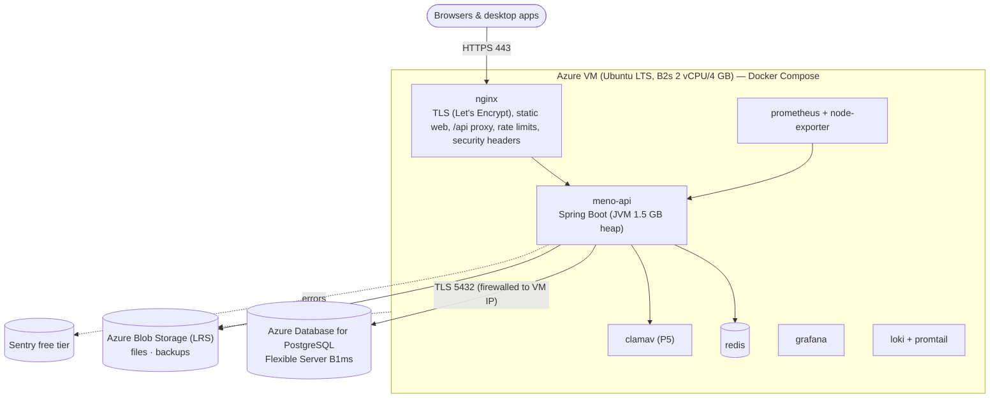

# Deploying MENO on Azure (student plan)

Owner: Jeeva. Approver: Nitheesh. Decision record: ADR-0005.

## Target topology

## Cost plan (Azure for Students — $100 credit, 12 months)

| Resource | SKU | Note |
|---|---|---|
| Staging VM | B2s, **auto-shutdown 20:00, start 09:00 (weekdays)** | Biggest cost — stop when idle |
| Production VM | B2s (from P5) | Always on |
| PostgreSQL Flexible | B1ms, 32 GB | Free 750 h/month for 12 months on eligible student subscriptions ⚠ verify in portal; one server can host `meno_staging` and `meno_prod` databases until pilot, then split |
| Blob Storage | Standard LRS, Hot (files) + Cool (backups) | Pennies |
| Bandwidth, IP | Standard public IP | Small |
| Redis | in Docker | Azure Cache for Redis is too expensive |

Budget alerts at $25 / $50 / $75. Jeeva reports spend at each sprint review. If credit runs low: one VM hosts staging via Compose profiles, or move production to a paid plan before pilot (decision by Nitheesh).

## Environments

| Env | Where | Deploy trigger | Data |
|---|---|---|---|
| local | developer laptop, `docker compose up` | — | seed |
| staging | VM `vm-meno-stg` | merge to `develop` (auto) | seed + anonymised demo |
| production | VM `vm-meno-prod` | tag `v*` on `main` + manual approval in GitHub Environment | real |

Naming: `rg-meno-<env>`, `vm-meno-<env>`, `psql-meno`, `stmeno<env>`, DNS `staging.<domain>`, `app.<domain>`.

## Pipeline

1. PR: build, unit + integration tests, Modulith verify, lint/typecheck/design check, parity vectors, CodeQL, Trivy.
2. Merge to `develop`: build images `ghcr.io/setupsworks/meno-api:<sha>`, `meno-web:<sha>` → SSH deploy to staging (`docker compose pull && up -d`) → Flyway runs on API start (as `meno_owner`) → smoke test → Playwright smoke.
3. Tag `vX.Y.Z` on `main`: same images re-tagged → manual approval → backup → deploy prod → smoke → rollback if smoke fails (previous tag).
4. Desktop: tag builds Windows installer (electron-builder) → GitHub Release → auto-update channel `stable` (staged: 10 % → 100 %).

## Database migrations in production

Flyway runs at startup. Migrations must be **backward compatible with the previous app version** (expand → migrate → contract over two releases) so rollback of the app is always possible. Destructive changes need Nitheesh approval and a fresh backup.

## Backups

Daily `pg_dump -Fc` 02:00 IST → Blob (Cool), retention 7 daily / 4 weekly / 12 monthly; plus Azure's built-in PITR (7 days). **Monthly restore drill** to a scratch DB, timed and recorded in `docs/runbooks/restore-drill-log.md`. Targets: RPO ≤ 24 h (≤ 5 min with PITR), RTO ≤ 4 h.

## Monitoring & alerts

Grafana dashboards: API (RPS, p95, 5xx), JVM, DB (CPU, connections, storage), business (invoices/hour, sync backlog). Alerts (email/Telegram): API down 2 min, 5xx > 2 %, p95 > 1 s, DB storage > 80 %, backup failed, cert < 14 days, device not synced 24 h.

Runbooks: [docs/runbooks/](../runbooks/README.md).
