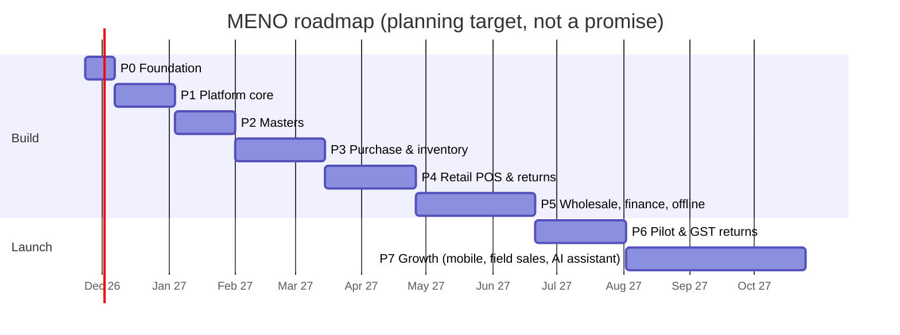

# Development phases

> Two-week sprints. Dates assume a start on **Mon 23 Nov 2026**; adjust in GitHub Projects if the start moves. A phase ends only when its **exit criteria** are met — not when the calendar says so.
> Nitheesh manages all phases: he approves each sprint plan and runs every phase gate.
> Feature IDs refer to [FEATURES.md](../product/FEATURES.md); every screen with its phase and owners is in [PAGES.md](../product/PAGES.md); owners per module in [OWNERSHIP_MATRIX.md](../team/OWNERSHIP_MATRIX.md). All work follows [VALIDATION_AND_BUSINESS_RULES.md](../architecture/VALIDATION_AND_BUSINESS_RULES.md). Per-person tasks for each phase: [`docs/team/members/<name>/PHASE_PLAN.md`](../team/members/).

| Phase | Sprints | Weeks | Approx. dates | Milestone |
|---|---|---|---|---|
| P0 Foundation | S0 | 2 | 23 Nov – 4 Dec 2026 | Docs, design, BRD approved; repo ready |
| P1 Platform core | S1–S2 | 4 | 7 Dec 2026 – 1 Jan 2027 | Login, tenants, roles, CI/CD, staging live |
| P2 Masters | S3–S4 | 4 | 4 Jan – 29 Jan 2027 | Companies, branches, items, parties |
| P3 Purchase & inventory | S5–S7 | 6 | 1 Feb – 12 Mar 2027 | Purchases create correct batch stock |
| P4 Retail POS & returns | S8–S10 | 6 | 15 Mar – 23 Apr 2027 | **Retail MVP** (online) on web + desktop |
| P5 Wholesale, finance, offline | S11–S14 | 8 | 26 Apr – 18 Jun 2027 | **Wholesale MVP + offline billing → Pilot-ready** |
| P6 Pilot & GST returns | S15–S17 | 6 | 21 Jun – 30 Jul 2027 | 3 pilot pharmacies live, GSTR exports |
| P7 Growth | S18+ | 12+ | Aug 2027 → | Mobile, field sales, analytics |

The base plan targeted 6 months to pilot. With offline sync, e-invoice and the compliance pack added, **~7 months to pilot-ready** is the honest estimate for a fresher team. Scope is cut (Should/Could items moved later), never quality.

---

## P0 — Foundation (Sprint 0)

**Goal:** everyone understands the product and the architecture; the repo, design and requirements are ready so coding can start in parallel without conflicts.

| Deliverable | Owner |
|---|---|
| Folder structure, AGENTS.md everywhere, architecture docs, ADRs | Nitheesh |
| BRD + FRS for Platform, Masters, Purchase, Inventory, POS; glossary review; 3 workflow diagrams | Prakalya |
| ER diagram v1, module package template, API guidelines review | Kamesh (+ Nitheesh) |
| Design system: tokens copied into `packages/ui`, Figma/wireframes for shell, POS, purchase entry | Meyyarivu |
| Test strategy, test-case template, first 40 GST/pricing test vectors drafted with Prakalya | Ashok |
| GitHub org/repo, branch protection, Projects board, Azure subscription + resource group, cost alerts | Jeeva |

**Exit criteria:** architecture review meeting held; BRD for P1–P3 signed off; board has P1 issues with acceptance criteria; everyone has run through `docs/team/ONBOARDING.md`.

## P1 — Platform core (S1–S2)

**Features:** PLT-01, 06, 07, 08, 12 (basic), scaffolding.

**Also (pages & roles):** AUT-01, NAV-01 — see [PAGES.md](../product/PAGES.md) for every screen of this phase.

| Deliverable | Owner |
|---|---|
| Spring Boot skeleton: modules, Modulith test, error handling, Flyway, Testcontainers base | Kamesh (Nitheesh reviews) |
| `security` (JWT + refresh rotation, cookie, `PermissionChecker`), `tenancy` (tenant filter, RLS setup, cross-tenant test base) | Kamesh (Nitheesh reviews) |
| `identity`, `auth`, `audit` base, configuration tables + `SettingsFacade`, OpenAPI export → `api-client` | Nitheesh (+ Kamesh) |
| Next.js skeleton (static export), `packages/ui` (shadcn new-york + tokens), app shell + sidebar (NAVIGATION.md), list/form/report page patterns, login, forgot/reset password, signup | Meyyarivu |
| Users, roles and permission screens (on Meyyarivu's patterns) | Nitheesh |
| Docker Compose (postgres, redis, minio, mailpit), Dockerfiles, CI (build/test/lint/scan), staging on App Service with auto-deploy (ADR-0018; VM + Nginx later) | Jeeva |
| API test collection, auth/role/tenant test cases, Playwright setup | Ashok |
| User stories P2, permission matrix (role × action), field validation catalogue | Prakalya (BA) |

**Exit:** a user can sign up a tenant, invite a user with a role, log in on staging; CI blocks a PR that breaks module boundaries; cross-tenant test suite runs.

## P2 — Masters (S3–S4)

**Features:** PLT-02, 03, 05, 13 · CAT-01…04, 06, 14 · PTY-01, 02, 03, 05, 10 · `files`.

**Also (pages & roles):** AUT-02, AUT-03, CAT-15, CAT-16, CAT-17, CAT-20, GST-09 — see [PAGES.md](../product/PAGES.md) for every screen of this phase.

| Deliverable | Owner |
|---|---|
| `catalog`, `party`, number series, tenant settings | Kamesh |
| `files` module (Blob/MinIO signed URLs), company/branch, edition guard | Nitheesh |
| Medicine, supplier, customer and doctor master screens | Ashok (FE) |
| Company, branch, settings, number-series screens; onboarding wizard backend | Nitheesh |
| Shared item/party search combobox, barcode input, onboarding wizard + checklist screens; UI review of masters | Meyyarivu |
| Seed data scripts, backups on staging, Grafana + Loki | Jeeva |
| Masters regression suite; validation test suite (every rule: valid / invalid / boundary) | Ashok |
| P3 FRS (purchase, inventory, schemes); finalise test vectors | Prakalya (BA) |

**Exit:** an admin can set up company → branch → items → suppliers/customers; all CRUD audited; masters regression passes.

## P3 — Purchase & inventory (S5–S7)

**Features:** PUR-01, 02, 04, 05, 07, 08 · INV-01, 02, 05, 06, 07, 10, 11, 12 · PRC-01, 04, 05, 09 · GST-01 · CAT-07, 08 · PLT-16 · RPT-03, 04, 05.

**Also (pages & roles):** ADM-06, CAT-18, CAT-19, DSH-04, GST-11, PTY-11, PUR-12, PUR-13, PUR-14, RPT-16 — see [PAGES.md](../product/PAGES.md) for every screen of this phase.

| Deliverable | Owner |
|---|---|
| `inventory` ledger, batches, adjustments, reconciliation job | Kamesh |
| `purchase` posting (PO, GRN, verification), `pricing` + `taxation` engines passing test vectors | Kamesh |
| `packages/billing-engine` (TS) passing same vectors; import centre; `reporting` framework + inventory dashboard API | Nitheesh |
| Reports centre screens (stock, expiry, purchase), inventory dashboard screens | Gokul |
| Purchase entry grid (keyboard), import mapping UI, stock & expiry screens | Meyyarivu |
| Purchase dashboard, GRN/verification screens | Meyyarivu |
| Pricing/scheme screens | Gokul |
| Medicine export/history, supplier price list screens | Ashok (FE) |
| Parity CI job (Java vs TS vectors); prod VM provisioned (not public) | Jeeva |
| Critical scenarios 1, 2, 3, 5 (TEST_STRATEGY), stock reconciliation tests | Ashok |
| Validation sessions with a real pharmacy on purchase flow | Prakalya (BA) |

**Exit:** purchase invoice (incl. free qty, discounts, GST) creates exact batch stock and supplier balance; import of a real distributor CSV works; expiry dashboard correct.

## P4 — Retail POS & returns (S8–S10)

**Features:** POS-01…07, 09…12, 16 · INV-03, 04 · RET-01…04, 06 · CMP-01, 03, 04, 05 · PRC-06, 07, 08 · GST-02 · RPT-01, 02, 09 · NTF-01, 02, 05 · DSK-01, 03, 04 · CAT-05, 09.

**Also (pages & roles):** ADM-02, ADM-03, ADM-04, CMP-09, DSH-01, DSH-02, DSH-07, DSH-08, INV-18, NAV-02, POS-20, POS-21, POS-22, RET-08, RPT-13, RPT-14, RPT-15 — see [PAGES.md](../product/PAGES.md) for every screen of this phase.

| Deliverable | Owner |
|---|---|
| `sales` invoice posting with FEFO, concurrency-safe consumption, idempotency | Kamesh |
| `returns` (with inspection), `compliance` (H1 register, prescriptions, restricted-medicine guard) | Kamesh |
| Electron shell: window, printing (thermal/A4), scanner, auto-update | Nitheesh + Jeeva |
| POS screen (keyboard map), invoice list, print templates, prescription capture | Meyyarivu |
| Returns UI, compliance registers | Ashok (FE) |
| Sales registers and reports, role-based dashboards + widget library | Gokul |
| Dashboard APIs, admin settings (payment, printer, notifications), `notification` module | Nitheesh |
| Windows installer signing + update channel | Jeeva |
| Concurrency test (scenario 6), duplicate request (11), H1 register checks, performance baseline | Ashok |
| UAT scripts for retail, training notes | Prakalya (BA) |

**Exit:** **Retail MVP** — a pharmacist bills a 5-line prescription incl. H1 drug in < 20 s online on desktop; returns and expiry returns work; UAT passed by Prakalya.

## P5 — Wholesale, finance, offline (S11–S14)

**Features:** WHS-01…06, 08, 09 · PRC-02, 03 · PTY-04, 06, 07 · ACC-01…06, 09 · INV-08, 09, 13, 15 · POS-08, 14, 15, 17, 19 · DSK-02, 05, 06 · PLT-04, 09, 10, 11, 19 · NTF-03, 04 · RPT-06, 07, 11 · RET-05 · CMP-07 · INT-01, 02.

**Also (pages & roles):** ACX-13, ADM-01, ADM-05, ADM-07, CMP-08, CRM-01, DSH-03, DSH-05, INV-16, INV-17, PRC-10, PRC-11, PTY-12, PTY-13, PUR-15, RET-07, WHS-13 — see [PAGES.md](../product/PAGES.md) for every screen of this phase.

| Deliverable | Owner |
|---|---|
| Sync module (server) + desktop sync engine & SQLite | Nitheesh |
| Wholesale orders → invoice, credit control, price lists, e-invoice integration | Kamesh |
| `payment`, `accounting` auto-posting, outstanding/ageing (backend + screens); dashboard and customer history APIs | Nitheesh |
| Wholesale screens (orders, credit, dispatch), transfers, sync-status UI | Meyyarivu |
| Price lists and schemes, e-invoice screens, finance & wholesale dashboards, customer history, outstanding/ageing/GST reports | Gokul |
| Customer groups and statements screens | Ashok (FE) |
| Production go-live: hardening, backups + restore drill, alerts, runbooks | Jeeva |
| Offline scenario 12, security tests (OWASP top 10, tenant), load test, full regression automation | Ashok |
| Pilot customer selection, onboarding guide, data migration checklist | Prakalya (BA) |

**Exit:** **Pilot-ready** — all 12 critical scenarios pass; restore drill done; pen-test findings High/Critical fixed; 3-day offline test passes.

## P6 — Pilot & GST returns (S15–S17)
**Also (pages & roles):** ACX-12, ADM-08, ADM-09, ADM-10, ADM-11, CMP-10, CMP-11, CRM-02, CRM-03, CRM-04, CRM-06, DSH-06, DSH-09, GST-10, WHS-11, WHS-12, WHS-14 — see [PAGES.md](../product/PAGES.md) for every screen of this phase.

GST-03, 04, 05, 07 · ACC-07, 08, 10 · PLT-14, 15, 17 · RPT-08, 10 · CMP-02 · POS-18 · INV-14 · pilot support rotation, bug-fix SLAs, feedback loop.

**Exit:** 3 pilot pharmacies (2 retail, 1 wholesale) running daily for 4 weeks with no data-integrity incidents.

## P7 — Growth
**Also (pages & roles):** ADM-12, CRM-05, CRM-07 — see [PAGES.md](../product/PAGES.md) for every screen of this phase.

Mobile owner app, wholesale field-sales app (MOB-*), fieldsales module, retailer portal, AI forecasting (RPT-12), public API, multi-language, e-commerce intake.

**AI assistant (AIA-01 … AIA-12):** plain-language, read-only questions over the tenant's own data on one shared LLM provider (Groq first). Design: [AI_ASSISTANT.md](../architecture/AI_ASSISTANT.md), ADR-0017. Platform pieces (login, membership, tenant schema, RLS) already exist from P1; P7 builds them in this order:

| Step | Work | Who |
|---|---|---|
| 1 | Question catalogue (30 real questions + expected answers); privacy review with the lawyer (R-52) | Prakalya |
| 2 | LLM provider comparison (Groq first: tool calling, latency, price, retention, terms) | Jeeva |
| 3 | ADR-0017 accepted (provider, model, client library, retention) | Nitheesh |
| 4 | Read-only query facades for the tools: sales, stock, bill quote (AIA-05, 06, 07) | Kamesh |
| 5 | Groq adapter + orchestrator + tool registry (AIA-03, 02, 04) | Nitheesh, Jeeva |
| 6 | Privacy, guards, assistant screen and settings (AIA-08, 09, 01, 10) | Nitheesh, Gokul |
| 7 | Audit, metrics, alerts, security test pack, critical scenario #16 (AIA-11) | Nitheesh, Jeeva, Ashok |
| 8 | Optional: store documents with pgvector (AIA-12) | Nitheesh, Gokul, Jeeva |

**AI exit:** critical scenario #16 and the AI security test pack pass; Prakalya accepts the answers to the question catalogue on demo data; R-52 confirmed before any real tenant turns it on.

---

## Phase gate checklist (every phase)

- [ ] All Must features of the phase merged to `develop` and deployed to staging
- [ ] QA sign-off (Ashok) with test report in `docs/testing/reports/`
- [ ] Business acceptance (Prakalya) against user stories
- [ ] `docs/planning/CURRENT_STATE.md` updated
- [ ] Release tagged, notes written, `main` updated (Nitheesh)
- [ ] Retrospective held; actions added to the board
