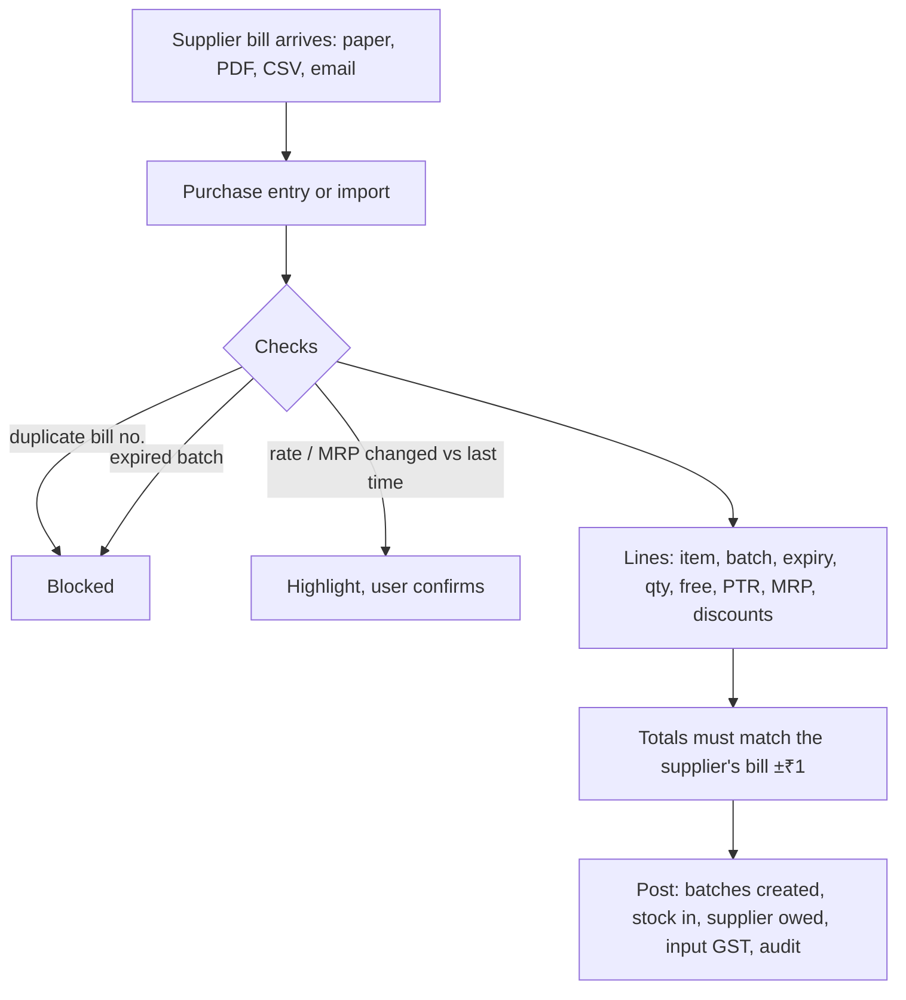
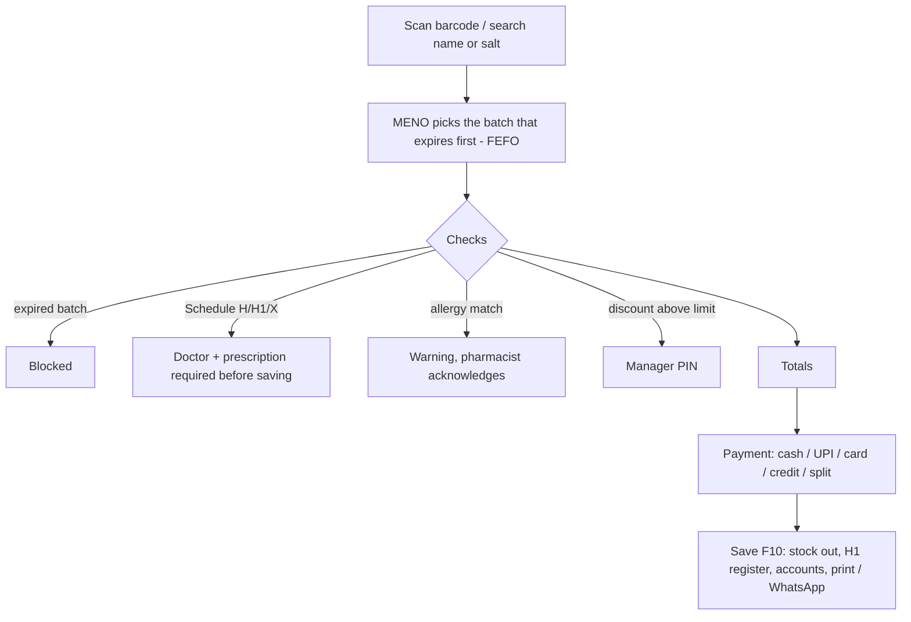
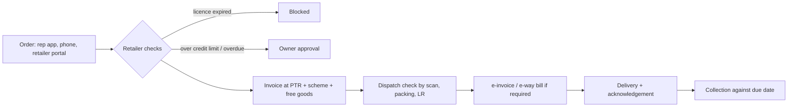

# How a pharmacy business works — and what MENO does at each step

> Prefer a course? Open **[docs/guide/meno-learning-guide.html](../guide/meno-learning-guide.html)**: the same material in simple English with calculators, a searchable glossary and every feature and screen.
>
> A plain-language guide for anyone new to medical billing (developers, testers, sales). Read it top to bottom once; then use it as a map: every step names the MENO feature (FEATURES.md), the screen (PAGES.md), the formula (CALCULATIONS.md) and the test vector (`contracts/test-vectors/`) that proves the maths. Words in **bold** are in [GLOSSARY.md](GLOSSARY.md). Rules marked ⚠ are researched but not yet signed off ([RESEARCHED_ANSWERS.md](../compliance/RESEARCHED_ANSWERS.md)).

## 1. The business in one page

- A **medicine** is sold in **batches**. Every batch has a batch number, an **expiry** (month/year), an **MRP** printed on the pack and a cost.
- The **MRP includes GST**. A retail shop can sell at MRP or below, **never above**.
- The wholesaler sells to the shop at **PTR** (price to retailer), **excluding GST**, usually on **credit**.
- Both shops need a **drug licence** (retail Form 20/21, wholesale 20B/21B) and a **GSTIN**.
- Some medicines are restricted (**Schedule H, H1, X, NDPS**): sold only on a doctor's **prescription**, some with a legal **register**.
- Medicines **expire**. Expired stock must never be sold; it goes back to the supplier for a **claim** or is destroyed.

So the software must get five things right every time: **price, tax, stock by batch, legal records, money owed**.

## 2. The documents and what each one changes

| Document | Who makes it | Stock | Money | GST | Legal record |
|---|---|---|---|---|---|
| Purchase invoice (supplier bill) | Shop / distributor entering a supplier's bill | **In** by batch | We owe the supplier | Input tax credit | — |
| POS bill / sales invoice | Counter or wholesale billing | **Out** by batch | Cash/bank in, or customer owes us | Output tax | H1 / X register if restricted |
| Sales return + credit note | When a customer returns goods | In (if saleable) | We owe the customer back | Output tax reduced | Linked to the original bill |
| Purchase return + debit note | Returning to supplier | Out | Supplier owes us | Input tax reduced | — |
| Expiry / breakage claim | Near-expiry or broken stock to supplier | Out (to supplier) | Claim until supplier's credit note | Via credit note | Destruction record if destroyed |
| Receipt / payment | Money in or out | — | Settles bills | — | — |
| Stock transfer | Between branches | Out at one, in at the other | — (or invoice if different GSTIN) | If GSTINs differ | — |
| Stock adjustment | Damage, count difference, write-off | ± | Loss / gain | — | Approval + reason |

**Rule that never bends:** a posted document is never edited or deleted. Mistakes are fixed with a reversing document (credit note, debit note, reversal). Stock changes only by adding movement rows. ([AGENTS.md](../../AGENTS.md) rules 4 and 6.)

## 3. Setting up (once)

Onboarding: [ONBOARDING.md](ONBOARDING.md). In order:

1. **Company & GST**: GSTIN, legal name, state (locked to the GSTIN), registration type (regular or composition).
2. **Licences & pharmacist** in charge.
3. **Books**: financial year (April–March), bank, opening balances (debits must equal credits).
4. **Masters**: suppliers, customers, medicines ([MASTER_FIELDS.md](MASTER_FIELDS.md)). Every medicine has an HSN code; **the GST rate comes from the HSN for the date**, never typed (R-01: most medicines 5 % from 22-09-2025, some Nil, some 18 %).
5. **Opening stock by batch** (batch, expiry, MRP, cost).
6. **Billing preferences**: number series, rounding, discount limits per role, near-expiry days.

## 4. Buying stock (purchase → stock)

**What is calculated** (CALCULATIONS §2, §5, §9):
- Line value = rate × quantity, minus scheme %, minus trade discount. GST is added on top (the PTR excludes GST).
- *Example (vector `schemes/free-and-scheme.json`)*: PTR ₹24.00 × 10 strips, 1 free, GST 5 % → taxable ₹240.00, GST ₹12.00, total ₹252.00. **Stock goes up by 11**, not 10.
- **Landed cost** per unit = (taxable + freight share + any GST you can't claim back) ÷ (billed + free units). *Example*: (₹240 + ₹18.14 freight share) ÷ 11 = **₹23.4673** per strip (`schemes/landed-cost.json`). Free goods make each unit cheaper; this is the cost used for profit.
- **Weighted average cost** updates after each purchase (`pricing/margin.json`).

Features: PUR-01…PUR-21 · Pages: `/purchase/invoices/new` · Spec: [DOCUMENT_FIELDS.md](DOCUMENT_FIELDS.md) §1.

## 5. Selling at the counter (retail POS)

**What is calculated** (CALCULATIONS §2–§4, §7, §8):
- The MRP **already includes GST**, so MENO works backwards: taxable = amount ÷ (1 + GST %), GST = the rest, rounded to the paisa.
- *Example (vector `gst/gst-core.json`)*: 2 strips at MRP ₹33.60, 10 % discount, GST 5 % → amount ₹60.48, taxable ₹57.60, CGST ₹1.44 + SGST ₹1.44, **bill ₹60.00** after a −₹0.48 round-off.
- Same state as the shop → split into **CGST + SGST**. Different state → one **IGST**.
- **Loose tablets**: price per tablet = MRP ÷ tablets per strip. *Example*: ₹33.60 ÷ 15 = ₹2.24; 5 tablets = ₹11.20 (`pricing/loose-sale.json`); stock goes down by 0.3333 strip.
- **Bill discount** (e.g. ₹10 off the whole bill) is shared across lines by value so each line's GST stays right (`pricing/bill-discount.json`).
- **Never above MRP**, whatever the discount maths.
- **Change due** for cash; **credit check** for credit customers (`accounting/payments.json`).

**Legal record**: a Schedule H1 sale writes a register line automatically — prescriber name and address, patient name, medicine, quantity, date — kept 3 years (R-18).

**Offline**: the desktop app bills even without internet using the same maths ([`packages/billing-engine`](../../packages/billing-engine)) and syncs later; offline bills are signed by the device (SEC-02).

Features: POS-01…POS-29 · Page: `/sales/pos` · Spec: DOCUMENT_FIELDS.md §2.

## 6. Selling to retailers (wholesale, order → cash)

- **Credit terms**: due date = invoice date + credit days. Overdue bills can carry **interest** (`accounting/interest-tds.json`): ₹10,000 at 18 % for 30 days = ₹147.95 (simple), and GST applies to that interest (R-06).
- **Schemes**: "10 + 1" free, scheme %, trade discount, cash discount — on the invoice they all reduce the taxable value before GST (R-05).
- **Combined bill**: one printed paper with sales, less returns, less breakage/expiry, add replacement, plus freight. Underneath, returns are separate **credit notes** (R-08). *Example (`documents/combined-bill.json`)*: grand total **₹578.00**, IGST ₹83.96.
- **E-invoice** if turnover exceeds ₹5 crore (report within 30 days at ₹10 crore+); **e-way bill** above ₹50,000 of goods moving (R-02, R-03) ⚠.

Features: WHS-01…WHS-22 · Spec: DOCUMENT_FIELDS.md §3, §3a.

## 7. Returns and expiry

| Situation | What MENO does |
|---|---|
| Patient returns a strip | Sales return against the original bill: same batch, same price and GST; stock back only if it passes inspection; refund or credit note |
| Expired or broken stock | Kept apart as not-for-sale; returned to the supplier as a claim; supplier's credit note settles it; or destroyed with a record (R-20) |
| Near-expiry | Dashboard at 30 / 60 / 90 days; suggests return, discount or moving stock to a branch where it sells |
| Wrong rate on a past bill | Financial credit / debit note, no stock movement |

Credit notes must be reported to GST by **30 November** after the year ends (R-08).

## 8. Money: who owes whom

- Every supplier and customer has a **ledger** (an account). Purchases and sales post to it automatically.
- **Receipts** are matched to the oldest bills first (FIFO) unless the user picks; extra money stays "on account" (`accounting/payments.json`: ₹650 against bills of ₹500 and ₹300 → ₹500 + ₹150, nothing left).
- **Ageing**: how old each unpaid bill is (0–30, 31–60 …) → reminders and collection lists.
- **TDS**: big buyers deduct tax on large purchases (e.g. 0.1 % above ₹50 lakh a year under 194Q; rules move to the Income Tax Act 2025 numbering from 01-04-2026) (`accounting/interest-tds.json`, R-11).
- **MSME suppliers** must be paid within 15 days (or up to 45 days with a written agreement), otherwise the expense is deductible only when paid (R-13).

## 9. Accounts happen automatically

Every posted document creates a balanced **voucher** (debits = credits) using posting rules ([CHART_OF_ACCOUNTS.md](../architecture/CHART_OF_ACCOUNTS.md)):

| Event | Debit | Credit |
|---|---|---|
| Cash sale ₹60 (GST ₹2.88) | Cash 60.00 | Sales 57.60 · Output CGST 1.44 · Output SGST 1.44 · Round Off (sign) |
| Credit sale to retailer | Retailer | Sales · Output GST · Round Off |
| Purchase on credit | Purchase · Input GST | Supplier |
| Customer pays | Cash / Bank | Customer |
| Expiry write-off | Expiry Loss | Stock |

From these come the day book, cash book, trial balance, profit & loss and balance sheet — nobody types them.

## 10. Day end, month end, year end

| When | What | MENO |
|---|---|---|
| Every shift / day | Count cash by denomination, close the counter, compare with sales by payment mode; owner gets a digest | POS-14, NTF-07 |
| Every day (night) | Stock ledger vs balances reconciled; record chains verified; backups | INV-12, SEC-01, SEC-15 |
| Every month | GSTR-1 (sales) and GSTR-3B (tax paid) prepared and exported; purchases matched with GSTR-2B / IMS; expiry returns sent; month locked | GST-03…05, GST-14, PLT-23 |
| Every year | Year-end closing, carry-forward balances, GSTR-9 if turnover > ₹2 crore, records kept 72 months after the annual-return due date | PLT-04, GST-13, R-09, R-33 |

## 11. What MENO always checks (the safety net)

1. Never sell above MRP; never sell an expired batch; never sell a banned drug.
2. No Schedule H/H1/X sale without a prescription; H1 register written automatically.
3. Totals are always recomputed by the server; the screen's numbers are never trusted.
4. Same bill never saved twice (idempotency), even if F10 is pressed twice or the network drops.
5. One tenant can never see another's data.
6. Rates, limits and thresholds come from dated settings, so a law change is a settings change, not a code change.
7. Every change is audited; posted records are tamper-evident.

## 12. Where each piece lives

| Topic | Read |
|---|---|
| All features | [FEATURES.md](FEATURES.md) |
| All screens | [PAGES.md](PAGES.md) |
| Fields on masters / documents | [MASTER_FIELDS.md](MASTER_FIELDS.md) · [DOCUMENT_FIELDS.md](DOCUMENT_FIELDS.md) |
| Formulas | [CALCULATIONS.md](../architecture/CALCULATIONS.md) |
| Proof of formulas | [`contracts/test-vectors/`](../../contracts/test-vectors/README.md) — 72 cases, all passing in `packages/billing-engine` |
| Law and practice answers | [RESEARCHED_ANSWERS.md](../compliance/RESEARCHED_ANSWERS.md) |
| Backend design | [BACKEND_IMPLEMENTATION.md](../architecture/BACKEND_IMPLEMENTATION.md) |
| Diagrams per workflow | [docs/workflows/](../workflows/README.md) |
| Interactive demo | MENO Hub → Learn → Day 21 |
