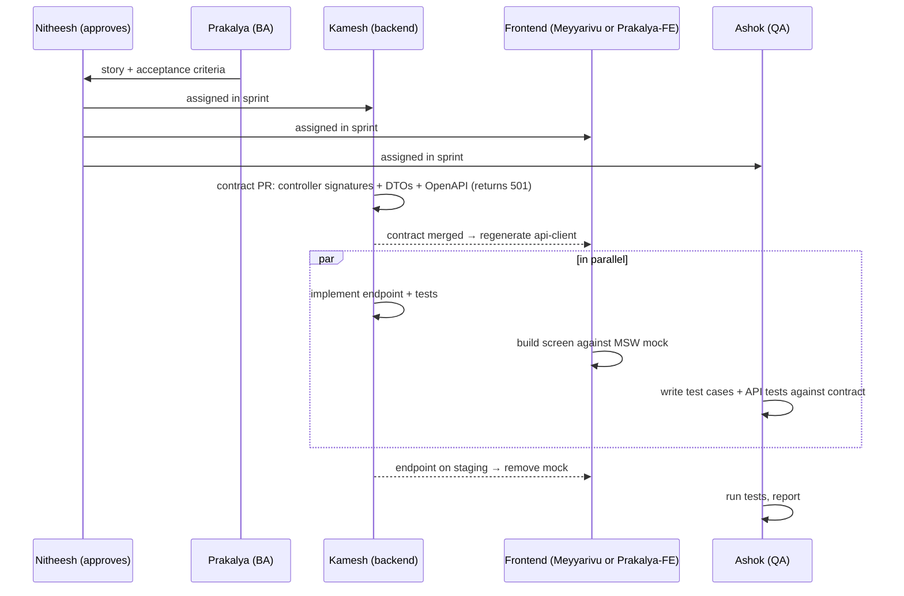

# Working in parallel without conflicts

Six people plus their AI agents in one repo. These rules keep merge conflicts, broken builds and "who changed my code?" moments rare. Nitheesh enforces them.

## 1. Ownership by path

Every path has an owner in `.github/CODEOWNERS` (summary in [members/README.md](members/README.md)); Nitheesh is second reviewer everywhere. You may change any file, but the owner reviews it. **Work inside your own paths by default**; for anything outside, open an issue or ask the owner first.

## 2. One issue → one branch → one small PR

- Branch: `feature/<issue#>-<short-name>` from latest `develop`.
- A PR should be reviewable in 20 minutes (< ~400 changed lines excluding generated files). Split big work into a stack of PRs.
- Rebase on `develop` **every morning** (`git pull --rebase origin develop`). Long-lived branches cause conflicts.
- Squash merge; delete the branch after merge.

## 3. Contract first between backend and frontend

Changing a merged contract = a new small PR approved by Kamesh and the frontend owner of that feature.

## 4. Frontend: three developers, no overlap

| Path | Owner |
|---|---|
| `packages/ui/**`, `apps/web/src/{components,lib,hooks,stores,config,styles}/**`, root layout | Meyyarivu |
| `features/{auth,catalog,purchase,inventory,pos,returns,wholesale,pricing,gst,compliance}` + their routes | Meyyarivu |
| `features/parties` + its routes | Prakalya |
| `features/{company,branches,users,settings,admin,dashboard,reports,accounting,payments,crm}` + their routes | Nitheesh |
| `apps/web/src/lib/query/keys.ts` | shared — **append only**, one line per key group, in your own section |
| Navigation menu config (`config/nav.ts`) | shared — append your entries in your section |

Need a shared component? Open a Hub task for Meyyarivu; she builds it in `packages/ui`. If it's urgent, build it locally in your feature folder and Meyyarivu moves it later. Owners per prefix: [OWNERSHIP_MATRIX.md](OWNERSHIP_MATRIX.md).

## 5. Hot files (everyone touches them) — special rules

| File | Rule |
|---|---|
| `db/migration/V*.sql` | Name with full timestamp `V202612081430__inventory_batch.sql` → no number clashes. Never edit merged migrations. If order collides, the later PR renames its file. |
| `contracts/openapi/meno-api.yaml` | **Generated** — never hand-edit. After rebasing, regenerate; conflicts are resolved by regenerating. |
| `packages/api-client/src/generated/**` | Generated — same rule. |
| `pom.xml`, root `package.json`, `pnpm-lock.yaml` | Dependency changes in a **separate tiny PR** approved by Nitheesh. Lockfile conflicts: take `develop`'s version and re-run install. |
| `application*.yml` | Add keys under your module's prefix (`meno.inventory.*`). |
| Design tokens (`packages/ui/src/tokens`) | Meyyarivu only; changes need Nitheesh. |
| `docs/planning/CURRENT_STATE.md` | Edit only your own row; add rows at the end of a section. |
| Permission seed | One new migration per module adding its permissions — never edit the shared seed. |
| `.github/workflows/*`, `infrastructure/**` | Jeeva only. |
| `docs/product/FEATURES.md` | Prakalya only; others suggest via issue. |

## 6. Module isolation in the backend

Each module has its own package, tables, migration prefix, permission prefix, config prefix and test package. Two engineers in two modules almost never conflict. If you need something from another module, add it to that module's `api/` in a small PR owned by its owner.

## 7. Feature flags for unfinished work

Merge unfinished features behind a flag (`meno.features.<name>=false` / `NEXT_PUBLIC_FLAG_<NAME>`) instead of keeping a branch alive for weeks. Remove flags within one phase after the feature is done.

## 8. AI agents and conflicts

- One agent per branch. Never two agents on the same branch at once.
- Tell the agent its scope: "only change files under `features/catalog/` and its tests". Changes outside scope get reverted in review.
- No drive-by formatting of files you didn't need to change.

## 9. Daily sync

15-minute stand-up run by Nitheesh: yesterday / today / blockers / **"I'll touch shared file X today"**. That last line prevents most conflicts.

## 10. If a conflict happens

1. Rebase; don't merge `develop` into your branch.
2. Generated files: regenerate. Lockfiles: take theirs, reinstall.
3. Code you don't own: ask its owner on the PR before resolving.
4. Run the full test suite after resolving.
