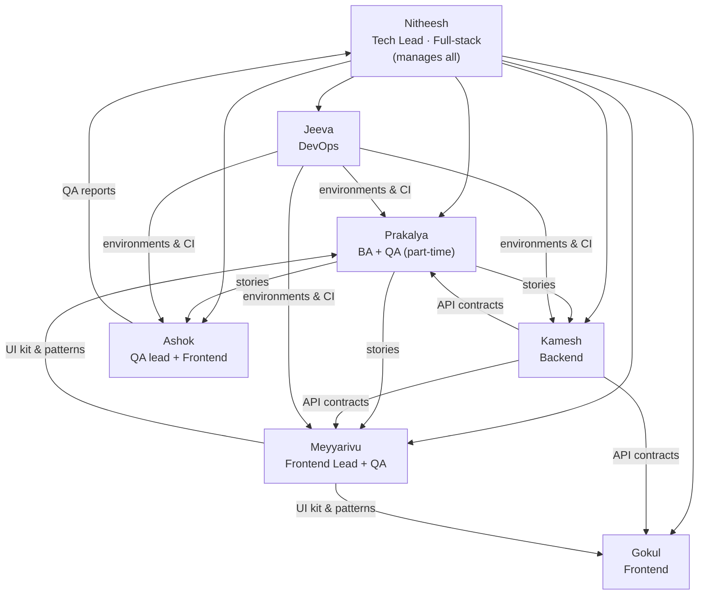

# Team and ownership

**Nitheesh manages everything** — product, people, architecture, delivery and releases.

| Track | Who |
|---|---|
| Backend | Kamesh, Nitheesh |
| Frontend | Meyyarivu (lead), Nitheesh, Ashok, Gokul |
| QA | Ashok (lead), Meyyarivu, Prakalya, Nitheesh: nobody tests their own work |
| DevOps | Jeeva | Everyone else owns an area and is its first reviewer. All members are early in their careers: pair and cross-train on purpose.

## RACI

R = does it · A = accountable (one per row) · C = consulted · I = informed

| Area | Nitheesh | Prakalya | Kamesh | Meyyarivu | Ashok | Jeeva | Gokul |
|---|---|---|---|---|---|---|---|
| Product direction, roadmap, priorities | A/R | R | C | C | C | C | C |
| Sprint planning & people management | A/R | C | C | C | C | C | C |
| Business requirements, stories | A | R | C | C | C | I | C |
| Architecture & ADRs | A/R | I | C | C | I | C | I |
| Backend platform (security, tenancy, sync) | A/R | I | C | I | C | I | I |
| Backend core modules (catalog, party, pricing, purchase, inventory, sales, returns, compliance, taxation) | A | C | R | I | C | I | I |
| Backend platform/finance/reporting modules | A/R | I | C | I | C | I | C |
| Frontend foundation, design system, transactional screens | A | C | I | R | C | I | C |
| Frontend admin, finance, licensing screens | A/R | C | I | C (UI review) | C | I | I |
| Frontend medicine master, parties, returns, compliance screens | A | C (UAT) | I | C (UI review) | R | I | I |
| Frontend pricing, GST, dashboards, reports, CRM, delivery, channels screens | A | C (UAT, CRM QA) | C (pricing/GST API) | C (UI review, DSH/RPT/ANX/OMN QA) | C (PRC/GST/DLV QA) | I | R |
| Desktop app (offline, devices) | A/R | I | I | R (renderer) | C | R (packaging) | I |
| GST/pricing maths & test vectors | A | R (values) | R (Java) | I | R (format) | I | C |
| Testing & release recommendation | A/R (PTY QA, final sign-off) | R (CAT/PTY/RET/CMP/CRM/ENG QA) | R | R (ADM/DSH/RPT/ANX/OMN QA) | R (QA lead) | C | C (fixes defects on own screens) |
| Infrastructure, CI/CD, monitoring | A | I | I | I | C | R | I |
| Production release | A/R | C | I | I | C (QA go) | R (deploy) | I |
| Business acceptance (UAT) | A | R | I | I | C | I | I |
| Security | A | I | R | R | R (testing) | R (infra) | R (frontend) |

Nitheesh is accountable for everything; the R column says who does the work.

## Backups (cross-training pairs)

Kamesh ↔ Nitheesh (backend) · Meyyarivu ↔ Nitheesh / Ashok / Gokul (frontend) · Gokul ↔ Meyyarivu (buddy, first month) · Ashok ↔ Prakalya (acceptance) · Ashok ↔ Meyyarivu (frontend) · Jeeva ↔ Nitheesh (infra & prod access).

Per-prefix owners: [OWNERSHIP_MATRIX.md](OWNERSHIP_MATRIX.md).

## Per-person details

[members/](members/README.md)
