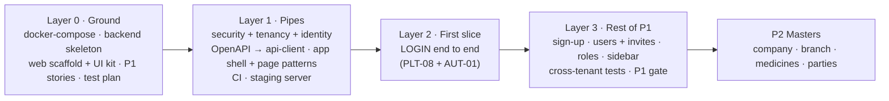

# What to build first (and how we meet every day)

> For all seven of us. **Open it live in MENO Hub → Start here**: the same build order with each milestone's real status, everyone's next Step, this week's goal and today's meeting topic. This page is the written version (keep it in step with `project-management/src/lib/build-order.ts`).
>
> Read this once, then bring it to the daily meeting. Your exact tasks, in order, are your **Steps** in MENO Hub → My tasks (same as `docs/team/members/<you>/TASK_ORDER.md`). This page explains **why that order** and **what to do while you wait**.

## 1. The one rule: build the road before the cars

Nothing works until the ground under it works. A login screen needs a web app, a design kit and a login API. A login API needs a backend skeleton, a database and tenant security. So we build in **layers**, and inside one layer everyone works **at the same time**.

**Why login is the first feature:** it is small, but it touches every layer: database, tenant, security, API contract, generated client, web screen, test, CI and staging. When login works on staging, the whole pipeline is proven and every later feature is "the same, again".

**After P1, the order follows how a pharmacy works** (you can't sell what you never bought):

| Phase | Build | Because |
|---|---|---|
| P2 Masters | Company, branch, medicines, suppliers, customers | Every bill needs an item and a party |
| P3 Purchase & stock | Purchase entry → batch stock → expiry | Stock only comes from purchases |
| P4 Retail POS & returns | Counter billing, returns, H1 register | A sale takes stock that already exists |
| P5 Wholesale, finance, offline | Credit sales, payments, accounts, offline sync | Built on top of sales and stock |
| P6 Pilot | Real pharmacies, GST returns | Only when the money and stock are proven right |

## 2. Who starts with what

"Needs" = what must exist before you can finish. **If it isn't ready, don't wait: use the "while you wait" column.**

| Who | First (your Steps) | Needs from | Unblocks | While you wait |
|---|---|---|---|---|
| **Jeeva** | `docker-compose.yml` (postgres, redis, minio, mailpit) → Dockerfiles → CI → staging VM | nothing | **everyone** (local DB, CI, staging) | Azure PostgreSQL staging, secrets in GitHub Environments |
| **Nitheesh** | Onboard Gokul → P0 gate → review Kamesh's skeleton, security, tenancy → identity + audit → settings framework → OpenAPI → api-client | Kamesh's skeleton + security + tenancy | Every frontend (api-client); identity, audit, settings for every module | Review Kamesh's PRs; users & roles screen on mocks |
| **Kamesh** | **Backend skeleton (#457) → `security/` (#458) → `tenancy/` (#7)** → help with identity/audit → permission seed → validation layer | Jeeva's compose (Postgres) | **All backend work**: Nitheesh (identity, api-client), P2 catalog + party APIs | Draft the P2 `catalog` / `party` OpenAPI contracts and migrations; Java twin of the billing engine (pure Java, no DB needed) |
| **Meyyarivu** | Next.js scaffold → `packages/ui` kit → app shell + sidebar → **page patterns** → validation kit → auth pages | nothing to start | Ashok, Gokul, Nitheesh (screens) | Pair with Gokul; design-check script |
| **Prakalya** | P1 user stories (signup, users, roles, login) → masters FRS + validation catalogue | nothing | Ashok (test cases), everyone (acceptance criteria) | Onboarding FRS, master-form FRS |
| **Ashok** | Playwright setup → auth / role / tenant test cases + API collection → review the 20 draft test vectors with Prakalya | Meyyarivu's web scaffold (for Playwright); Prakalya's stories | QA of every P1 feature | Test vectors for CALCULATIONS.md §7–§22 |
| **Gokul** | Onboarding → read docs → learn the stack with Meyyarivu → ReportPage skeleton → query keys + MSW mocks | Meyyarivu's page patterns | Dashboards and reports in P3–P5 | Learn GST and pricing maths; dashboard widget blocks on mocks |

**Two hand-offs decide our speed. Watch them every day:**
1. **Web scaffold + UI kit + page patterns** (Meyyarivu) → nobody else can build a real screen before this.
2. **Backend skeleton, security, tenancy** (Kamesh) **+ OpenAPI → api-client** (Nitheesh) → no feature API before this; no generated types for screens before this.

## 3. Calendar: the next six weeks

Dates from [PHASES.md](../planning/PHASES.md). If a goal slips, we move scope, not quality.

| Week | Goal (by Friday) | Highlights |
|---|---|---|
| **Wed 25 – Fri 27 Nov** | Gokul onboarded; everyone knows their first Step | Gokul: Hub account, setup, read docs · Meyyarivu + Gokul: first pairing · Prakalya: P1 stories started · Ashok + Prakalya: hand-check the 20 vectors |
| **Mon 30 Nov – Fri 4 Dec** | **P0 gate passed** (Fri): every P1 task has acceptance criteria and an owner | Prakalya: P1 stories done · Jeeva: `docker-compose` running on every laptop · Nitheesh: P0 gate, Sprint 1 plan |
| **Mon 7 – Fri 11 Dec** (Sprint 1, week 1) | **Layer 0 done**: `./mvnw verify` and `pnpm dev` work for everyone | Kamesh: backend skeleton (#457) · Meyyarivu: scaffold + UI kit · Jeeva: Dockerfiles + CI on PRs · Ashok: Playwright on the scaffold · Gokul: learn on the real scaffold |
| **Mon 14 – Fri 18 Dec** (Sprint 1, week 2) | **Layer 1 done**: security + tenancy, api-client generated, app shell + page patterns merged | Kamesh: security (#458), tenancy (#7) · Nitheesh: identity, OpenAPI → api-client · Meyyarivu: shell + sidebar + ListPage/FormPage/ReportPage · Jeeva: staging VM · Gokul: ReportPage skeleton · **Demo Fri** |
| **Mon 21 – Thu 24 Dec** (Sprint 2, week 1) | **Login works on staging** (first slice) | Nitheesh: PLT-08 login API · Meyyarivu: login, forgot/reset pages · Ashok: login E2E + cross-tenant test #9 · Jeeva: HTTPS staging with a real domain |
| **Mon 28 Dec – Fri 1 Jan** (Sprint 2, week 2) | **P1 exit**: sign up a tenant, invite a user with a role, log in on staging | Nitheesh: signup, users, roles · Kamesh: permission seed, cross-tenant base · Meyyarivu: signup wizard, sidebar · Prakalya: UAT P1 · Ashok: QA P1 · **P1 gate Fri** |

Holidays (25 Dec, 1 Jan): agree in the meeting the week before; move the goal, don't skip the demo.

## 4. The daily 1-hour meeting

Same time every day; Nitheesh runs it and keeps time. Cameras on, Hub open on the shared screen. **It ends on time.**

| Minutes | What | How |
|---|---|---|
| 0–15 | **Stand-up**, 2 min each | 1) what I finished · 2) what I do today (Step number) · 3) what blocks me · 4) shared files I'll touch (`keys.ts`, `nav.ts`, migrations, `packages/ui`) |
| 15–25 | **Board walk** in Hub | Right to left: QA → In review → In progress. Finish before starting. Anything **blocked** gets a name and a time to unblock it today |
| 25–50 | **Topic of the day** (below) | One topic, one owner, prepared before the meeting |
| 50–60 | **Pairs + decisions** | Who pairs with whom today; write every decision in the Hub task or an ADR (not only in chat) |

**Topic of the day (rotates by weekday):**

| Day | Topic | Owner |
|---|---|---|
| Mon | Plan the week: pick the week's goal from §3, check the two hand-offs | Nitheesh |
| Tue | **Contract review**: API shapes and OpenAPI PRs for the next features (backend + frontend owners agree before coding) | Kamesh / Nitheesh |
| Wed | **Show how**: one person shows code they wrote (a pattern, a test, a tricky bug) | Rotates: Meyyarivu, Ashok, Jeeva, Gokul… |
| Thu | **Learn pharmacy**: one concept from GLOSSARY / CALCULATIONS (batch, PTR, scheme, H1, GST rounding) + next week's stories | Prakalya |
| Fri | **Demo on staging** + 10-min retro (keep / change / try) | Everyone shows what merged |

**Meeting rules**
- If a topic needs more than 5 minutes, it moves to a separate call with only the people it involves.
- "I'm blocked" is never bad news. Hiding it is.
- Nobody tests their own work; QA owners are in [OWNERSHIP_MATRIX.md](OWNERSHIP_MATRIX.md).
- Code still goes branch → PR → review ([WORKFLOW.md](WORKFLOW.md)); the meeting doesn't replace reviews.

## 5. "I'm waiting for someone": what to do

| You are waiting for | Do this instead |
|---|---|
| The backend API | Contract PR merged? Build against **MSW mocks**. No contract yet? Ask for it at Tuesday's contract review |
| A shared UI component | Build it inside your feature folder; open a Hub task for Meyyarivu to move it to `packages/ui` |
| A business rule | Ask Prakalya in the Hub task. **Never invent a pharmacy or tax rule** |
| A review | Review someone else's PR meanwhile; mention it at stand-up |
| Staging / CI | Run locally with `docker-compose`; tell Jeeva at stand-up |
| Nothing to do | Take your next Step. Still nothing? Ask Nitheesh for a pairing task |

---

Related: [PHASES.md](../planning/PHASES.md) (phase goals and exit criteria) · [WORKFLOW.md](WORKFLOW.md) (branches, PRs, ceremonies) · [OWNERSHIP_MATRIX.md](OWNERSHIP_MATRIX.md) (who owns what) · [members/](members/README.md) (each person's plan).
